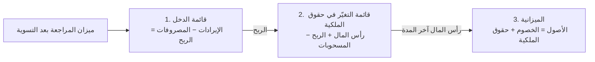

# من ميزان المراجعة إلى القوائم المالية

ميزان المراجعة بعد التسوية فيه كل ما نحتاجه للتقارير. الكورس التالي يتعمّق في كل قائمة. هنا نبني القوائم الثلاث الأساسية لمشروع صغير مثل مخبز نور.

## الترتيب مهم

كل قائمة تغذّي التالية: الربح يدخل حقوق الملكية، ورأس المال آخر المدة يدخل الميزانية.

## 1. قائمة الدخل

**مخبز نور، قائمة الدخل عن الشهر المنتهي في 30 يونيو**

| | | |
|---|---|---|
| **الإيرادات** | | |
| إيراد المبيعات | | 3,800 |
| **المصروفات** | | |
| الأجور | 1,050 | |
| الإيجار | 1,000 | |
| المستلزمات | 900 | |
| الكهرباء | 300 | |
| الإهلاك | 120 | |
| إجمالي المصروفات | | 3,370 |
| **صافي الربح** | | **430** |

لاحظ العنوان: يغطي **فترة** ("عن الشهر المنتهي في")، لأن الربح يُكسب على مدار الوقت.

## 2. قائمة التغيّر في حقوق الملكية

**عن الشهر المنتهي في 30 يونيو**

| | |
|---|---|
| رأس مال نور، 1 يونيو | 0 |
| يُضاف: إيداعات المالكة | 20,000 |
| يُضاف: صافي الربح | 430 |
| يُطرح: المسحوبات | (500) |
| **رأس مال نور، 30 يونيو** | **19,930** |

المبالغ بين الأقواس تُطرح.

## 3. الميزانية (قائمة المركز المالي)

**مخبز نور، الميزانية في 30 يونيو**

| **الأصول** | | |
|---|---|---|
| النقدية | | 9,400 |
| العملاء | | 700 |
| المستلزمات | | 600 |
| إيجار مدفوع مقدمًا | | 2,000 |
| *إجمالي الأصول المتداولة* | | *12,700* |
| المعدات | 8,000 | |
| يُطرح: مجمع الإهلاك | (120) | 7,880 |
| **إجمالي الأصول** | | **20,580** |
| **الخصوم** | | |
| الموردون | | 500 |
| أجور مستحقة | | 150 |
| *إجمالي الخصوم* | | *650* |
| **حقوق الملكية** | | |
| رأس مال نور | | 19,930 |
| **إجمالي الخصوم وحقوق الملكية** | | **20,580** |

العنوان يقول **"في 30 يونيو"**: الميزانية صورة ليوم واحد.

متوازنة: 20,580 = 650 + 19,930.

## ماذا تقول التقارير لنور؟

- المخبز حقق **ربحًا صغيرًا (430)** في شهره الأول، بعد احتساب كل ما استخدمه.
- الربح 11% من المبيعات (430 ÷ 3,800). الأجور والإيجار تأكل معظم الإيراد: زيادة المبيعات بدون تعيين المزيد هي الطريق للأعلى.
- النقدية جيدة (9,400)، والأصول المتداولة (12,700) تغطي الخصوم المتداولة (650) بسهولة.
- سحبت 500 لنفسها، أكثر من ربح الشهر. لا بأس لشهر واحد، لكن ليس كعادة.

هذه إجابة سؤال "هل أنا أكسب؟"، وجاءت مباشرة من الدفاتر.
