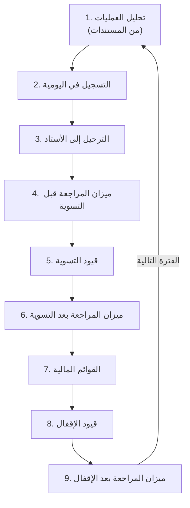

# إقفال الدفاتر والدورة المحاسبية

الإيرادات والمصروفات والمسحوبات تقيس **فترة واحدة**. عندما تنتهي الفترة، يجب أن تبدأ من الصفر في الفترة التالية. نقل أرصدتها إلى رأس المال اسمه **الإقفال (Closing)**، والحسابات التي تُقفل اسمها **حسابات مؤقتة** (أو *حسابات النتيجة*).

حسابات الميزانية (أصول، خصوم، رأس مال) **دائمة**: أرصدتها تنتقل للفترة التالية.

## قيود الإقفال الأربعة

مشروعات كثيرة تستخدم حسابًا مساعدًا اسمه **ملخص الدخل (Income summary)** أو *حساب الأرباح والخسائر*، يعيش فقط أثناء الإقفال.

**1. إقفال الإيرادات** (اجعل كل حساب إيراد مدينًا ليصبح صفرًا):

| 30 يونيو | مدين | دائن |
|---|---|---|
| من حـ/ إيراد المبيعات | 3,800 | |
| &nbsp;&nbsp;&nbsp;&nbsp;إلى حـ/ ملخص الدخل | | 3,800 |

**2. إقفال المصروفات** (اجعل كل حساب مصروف دائنًا):

| 30 يونيو | مدين | دائن |
|---|---|---|
| من حـ/ ملخص الدخل | 3,370 | |
| &nbsp;&nbsp;&nbsp;&nbsp;إلى مذكورين: حـ/ مصروف الأجور | | 1,050 |
| &nbsp;&nbsp;&nbsp;&nbsp;حـ/ مصروف الإيجار | | 1,000 |
| &nbsp;&nbsp;&nbsp;&nbsp;حـ/ مصروف المستلزمات | | 900 |
| &nbsp;&nbsp;&nbsp;&nbsp;حـ/ مصروف الكهرباء | | 300 |
| &nbsp;&nbsp;&nbsp;&nbsp;حـ/ مصروف الإهلاك | | 120 |

ملخص الدخل الآن رصيده دائن 3,800 − 3,370 = **430**: الربح.

**3. إقفال ملخص الدخل في رأس المال:**

| 30 يونيو | مدين | دائن |
|---|---|---|
| من حـ/ ملخص الدخل | 430 | |
| &nbsp;&nbsp;&nbsp;&nbsp;إلى حـ/ رأس مال نور | | 430 |

(في حالة الخسارة يكون العكس: من حـ/ رأس المال إلى حـ/ ملخص الدخل.)

**4. إقفال المسحوبات في رأس المال:**

| 30 يونيو | مدين | دائن |
|---|---|---|
| من حـ/ رأس مال نور | 500 | |
| &nbsp;&nbsp;&nbsp;&nbsp;إلى حـ/ مسحوبات نور | | 500 |

رأس المال الآن 20,000 + 430 − 500 = **19,930**، بالضبط كما في قائمة التغيّر في حقوق الملكية.

## ميزان المراجعة بعد الإقفال

تبقى الحسابات الدائمة فقط:

| الحساب | مدين | دائن |
|---|---|---|
| النقدية | 9,400 | |
| العملاء | 700 | |
| المستلزمات | 600 | |
| إيجار مدفوع مقدمًا | 2,000 | |
| المعدات | 8,000 | |
| مجمع الإهلاك | | 120 |
| الموردون | | 500 |
| أجور مستحقة | | 150 |
| رأس مال نور | | 19,930 |
| **الإجمالي** | **20,700** | **20,700** |

يوليو يبدأ من هنا، والإيرادات والمصروفات صفر.

## الدورة المحاسبية

كل ما في هذا الكورس، بالترتيب:

الخطوات 1 إلى 3 تحدث كل يوم. والخطوات 4 إلى 9 في نهاية كل فترة: شهريًا للإدارة، وسنويًا للضرائب والتقارير المنشورة.

## في الشركات

الشركة (وليس المالك الفرد) تُقفل الربح في **الأرباح المحتجزة (Retained earnings)** بدل رأس المال، وتوزّع **أرباحًا على المساهمين** بدل المسحوبات. الآلية نفسها تمامًا. وبرامج المحاسبة تُقفل السنة بأمر واحد، لكنها تعمل هذه القيود الأربعة بالضبط.

## جرّب بنفسك

أرصدة مدرّس خصوصي بعد التسوية في آخر السنة: إيراد الدروس 30,000؛ مصروف الإيجار 6,000؛ مصروف المواصلات 2,000؛ رأس المال 15,000؛ المسحوبات 9,000. كم رأس المال بعد الإقفال؟

**الإجابة:** الربح = 30,000 − 6,000 − 2,000 = 22,000. رأس المال = 15,000 + 22,000 − 9,000 = **28,000**.
