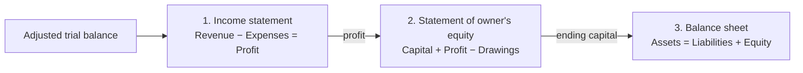

# From the trial balance to the reports

The adjusted trial balance has everything needed for the reports. The next course goes deep into each one. Here is how to build the three basic ones for a small business like Nour's.

## The order matters

Each report feeds the next: profit goes into equity, and ending equity goes into the balance sheet.

## 1. Income statement

**Nour's Bakery, Income statement for the month ended June 30**

| | | |
|---|---|---|
| **Revenue** | | |
| Sales revenue | | 3,800 |
| **Expenses** | | |
| Wages | 1,050 | |
| Rent | 1,000 | |
| Supplies | 900 | |
| Utilities | 300 | |
| Depreciation | 120 | |
| Total expenses | | 3,370 |
| **Net income** | | **430** |

Note the heading: it covers a **period** ("for the month ended"), because profit is earned over time.

## 2. Statement of owner's equity

**For the month ended June 30**

| | |
|---|---|
| Nour, capital, June 1 | 0 |
| Add: investment | 20,000 |
| Add: net income | 430 |
| Less: drawings | (500) |
| **Nour, capital, June 30** | **19,930** |

Amounts in brackets are subtracted.

## 3. Balance sheet

**Nour's Bakery, Balance sheet as of June 30**

| **Assets** | | |
|---|---|---|
| Cash | | 9,400 |
| Accounts receivable | | 700 |
| Supplies | | 600 |
| Prepaid rent | | 2,000 |
| *Total current assets* | | *12,700* |
| Equipment | 8,000 | |
| Less: accumulated depreciation | (120) | 7,880 |
| **Total assets** | | **20,580** |
| **Liabilities** | | |
| Accounts payable | | 500 |
| Wages payable | | 150 |
| *Total liabilities* | | *650* |
| **Owner's equity** | | |
| Nour, capital | | 19,930 |
| **Total liabilities and equity** | | **20,580** |

The heading says **"as of June 30"**: the balance sheet is a photo of one day.

It balances: 20,580 = 650 + 19,930.

## What the reports tell Nour

- The bakery made a **small profit (430)** in its first month, after paying for everything it used.
- Profit is 11% of sales (430 ÷ 3,800). Wages and rent eat most of the revenue: growing sales without hiring more is the way up.
- Cash is healthy (9,400), and current assets (12,700) easily cover current liabilities (650).
- She took out 500 for herself, more than the month's profit. Fine for one month, not as a habit.

That's the answer to "am I making money?", and it came straight from the bookkeeping.
