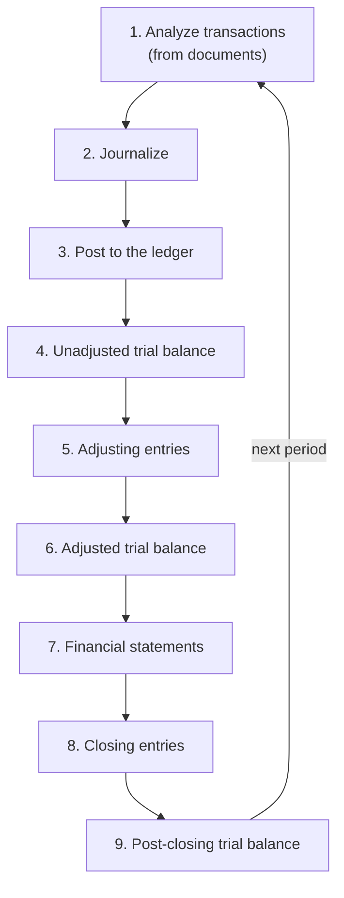

# Closing the books and the accounting cycle

Revenue, expenses and drawings measure **one period**. When the period ends, they must start again from zero for the next one. Moving their balances into Capital is called **closing**, and the accounts that get closed are called **temporary** (or *nominal*) accounts.

Balance sheet accounts (assets, liabilities, capital) are **permanent**: their balances carry over.

## The four closing entries

Many businesses use a helper account, **Income summary**, that exists only during closing.

**1. Close revenue** (debit each revenue account to bring it to zero):

| Jun 30 | Debit | Credit |
|---|---|---|
| Sales revenue | 3,800 | |
| &nbsp;&nbsp;&nbsp;&nbsp;Income summary | | 3,800 |

**2. Close expenses** (credit each expense account):

| Jun 30 | Debit | Credit |
|---|---|---|
| Income summary | 3,370 | |
| &nbsp;&nbsp;&nbsp;&nbsp;Wages expense | | 1,050 |
| &nbsp;&nbsp;&nbsp;&nbsp;Rent expense | | 1,000 |
| &nbsp;&nbsp;&nbsp;&nbsp;Supplies expense | | 900 |
| &nbsp;&nbsp;&nbsp;&nbsp;Utilities expense | | 300 |
| &nbsp;&nbsp;&nbsp;&nbsp;Depreciation expense | | 120 |

Income summary now has a credit balance of 3,800 − 3,370 = **430**: the profit.

**3. Close Income summary to Capital:**

| Jun 30 | Debit | Credit |
|---|---|---|
| Income summary | 430 | |
| &nbsp;&nbsp;&nbsp;&nbsp;Nour, capital | | 430 |

(A loss would be the other way round: debit Capital, credit Income summary.)

**4. Close Drawings to Capital:**

| Jun 30 | Debit | Credit |
|---|---|---|
| Nour, capital | 500 | |
| &nbsp;&nbsp;&nbsp;&nbsp;Nour, drawings | | 500 |

Capital is now 20,000 + 430 − 500 = **19,930**, exactly what the statement of owner's equity showed.

## Post-closing trial balance

Only permanent accounts remain:

| Account | Debit | Credit |
|---|---|---|
| Cash | 9,400 | |
| Accounts receivable | 700 | |
| Supplies | 600 | |
| Prepaid rent | 2,000 | |
| Equipment | 8,000 | |
| Accumulated depreciation | | 120 |
| Accounts payable | | 500 |
| Wages payable | | 150 |
| Nour, capital | | 19,930 |
| **Totals** | **20,700** | **20,700** |

July starts from here, with revenue and expenses at zero.

## The accounting cycle

Everything in this course, in order:

Steps 1 to 3 happen every day. Steps 4 to 9 happen at the end of each period: monthly for management, yearly for tax and published reports.

## In companies

A company (not a sole owner) closes profit into **Retained earnings** instead of Capital, and pays **dividends** instead of drawings. The mechanics are identical. Accounting software also closes the year for you with one command, but it does exactly these four entries.

## Try it

A tutor's adjusted balances at year end: Tuition revenue 30,000; Rent expense 6,000; Travel expense 2,000; Capital 15,000; Drawings 9,000. What's Capital after closing?

**Answer:** profit = 30,000 − 6,000 − 2,000 = 22,000. Capital = 15,000 + 22,000 − 9,000 = **28,000**.
