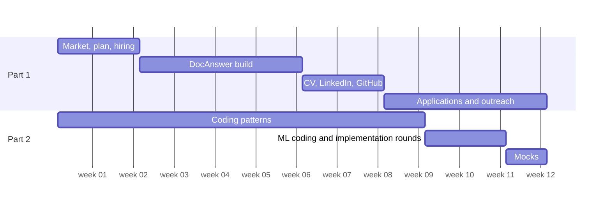

# فجوة مهاراتك وخطتك

قيّم نفسك من 0 إلى 3 في كل سطر (0: لم أستخدمه، 1: اتبعت درسًا، 2: بنيت شيئًا وحدي، 3: أستطيع شرحه في مقابلة وإصلاح أخطائه تحت الضغط). وكن صارمًا.

| المجال | المهارات | أين تسد الفجوة |
|---|---|---|
| البرمجة | بايثون وGit والاختبارات وSQL | *بايثون: الدورة الكاملة* |
| الخلفية (Back end) | واجهات REST وasync وقاعدة بيانات | دورة *FastAPI* |
| النشر | Docker وCI/CD والنشر على السحابة | *Docker وKubernetes*، وخطوات المشروع هنا |
| تطبيقات LLM | الأوامر، والمخرجات المنظمة، واستدعاء الأدوات، وRAG | مشروع هذا الجزء، والجزء 3 |
| التقييم | مجموعات الإجابات الذهبية، ومقاييس الاسترجاع، وLLM-as-judge | مشروع هذا الجزء، والجزء 3 |
| أساسيات تعلّم الآلة | التدريب والاختبار، والمقاييس، والإفراط في التخصيص، والتضمينات | مسار *تعلّم الآلة* (اختياري) |
| الـ agents | tool calling، والـ MCP، وحلقة agent بحدود وموافقة | الجزء 3، والدورة القصيرة *LangChain and LangGraph* |
| معرفة النماذج | كيف تعمل الـ LLMs، والـ reasoning models والنماذج متعددة الوسائط، وموازنات الـ fine-tuning | الجزء 3، والدورة القصيرة *LLMs: how they work* |
| المقابلات | أنماط الخوارزميات، وتصميم الأنظمة، والأسئلة السلوكية | الجزآن 2 و3، والوحدة 9 هنا |

## خطتك الأسبوعية

ضع فترات ثابتة في تقويمك كأنها وظيفة جزئية: مثلًا ساعتان في 5 أمسيات من أيام الأسبوع، وفترة 6 ساعات في العطلة. والساعات التي *تنوي* المذاكرة فيها فقط لا تُحسب. وراجع كل جمعة: ماذا أُنجز، وماذا تأخر، وماذا يتغير الأسبوع القادم.

## شكل الأسابيع الاثني عشر

التواريخ مجرد مثال، والفكرة أن التقديمات تبدأ وأنت ما زلت تتدرب، لا بعد أن تنتهي. والجزء 3 يأتي بعدها، أو بالتوازي حين يُطلق DocAnswer.
