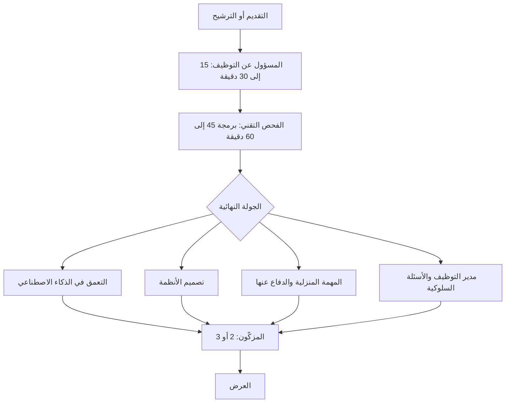

# جولات المقابلات مرحلةً مرحلة

جمع [الدليل](https://github.com/alexeygrigorev/ai-engineering-field-guide) العمليات التي تصفها الشركات ويرويها المتقدمون: **متوسط العملية 4 خطوات** (أغلبها من 3 إلى 5)، وتستغرق عادةً **من أسبوعين إلى 6 أسابيع**.

| المرحلة | المدة | ما تختبره | تستعد لها في |
|---|---|---|---|
| مقابلة المسؤول عن التوظيف | 15 إلى 30 دقيقة | الملاءمة، والدافع، والراتب المتوقع، والترتيبات | الوحدة 9 |
| الفحص التقني | 45 إلى 60 دقيقة | برمجة مباشرة (على نمط LeetCode أو عملية) | الجزء 2 |
| التعمق في الذكاء الاصطناعي وتعلّم الآلة | 45 إلى 90 دقيقة | LLMs وRAG والهلوسة، والضبط الدقيق مقابل الأوامر | الجزء 3 |
| تصميم الأنظمة | نحو 60 دقيقة | تصميم نظام ذكاء اصطناعي، والتكلفة والزمن والحجم | الجزء 3 |
| المهمة المنزلية | 2 إلى 4 ساعات عمل، و2 إلى 7 أيام للتسليم | بناء نظام RAG أو وكيل ثم الدفاع عنه | الجزء 3 |
| مدير التوظيف | 45 إلى 60 دقيقة | التعمق في مشاريعك وتحمّل المسؤولية | مشروعك، والوحدة 9 |
| الأسئلة السلوكية | 30 إلى 60 دقيقة | القيم، والخلاف، والغموض، وقصص STAR | الوحدة 9 |

ومن 51 شركة عمليتها موثقة، **تستخدم 17 شركة (33%) مهمة منزلية**، وتستخدم 5 شركات أيام عمل مدفوعة بدلًا منها. وكثير من كبرى الشركات تطلب أيضًا **من 2 إلى 3 مُزكّين** من مديرين وزملاء حديثين: فحافظ على تلك العلاقات من الآن.
