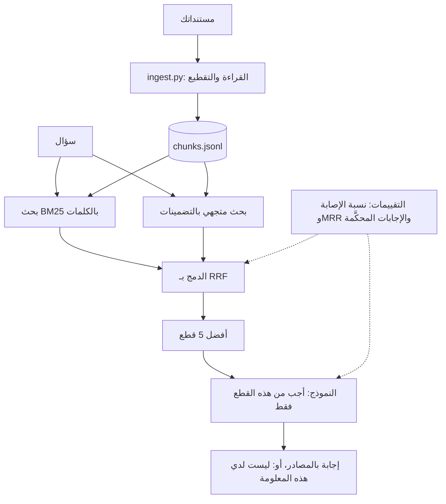

# اختر مشروعًا يهتم به مديرو التوظيف

مشروعك الأول هو **DocAnswer**: مساعد يجيب عن أسئلة حول مجموعة مستندات حقيقية، مع ذكر المصادر، وقول «لا أعرف» حين لا تذكر المستندات الإجابة، وقياس الجودة، وعرض تجريبي منشور. إنه أكثر الأنماط طلبًا (RAG)، ويروي الدليل أن **أنظمة RAG تمثل أكثر من 40% من المهام المنزلية**. فبناؤه جيدًا تدريب مباشر على المقابلات.

## ماذا ستبني

ستبنيه في الوحدات من 3 إلى 6: القراءة والبحث أولًا، ثم قياس الاسترجاع، ثم الإجابات وتقييمها، ثم الواجهة البرمجية وDocker والعرض.

## اختر مستندات تجعله مشروعك أنت

تجنب الأمثلة المكررة في الدروس. واختر مستندات لها مستخدمون حقيقيون وأسئلة حقيقية، ويُسمح لك باستخدامها:

- قانون العمل في بلدك، أو لوائح عامة لإحدى الوزارات
- دليل الطالب ولوائح المقررات في جامعة
- توثيق مشروع مفتوح المصدر
- سياسات شركات عامة أو أدلة منتجات في المجال الذي تستهدفه

استهدف من 200 إلى 2000 صفحة. ودوّن 3 أشخاص حقيقيين سيستخدمونه: ستختبره معهم وتقتبس منهم في ملف README.

## ماذا تعني «انتهيت» (قائمتك للوحدات الأربع القادمة)

- [ ] قراءة المستندات وتقطيعها مع المصدر ورقم الصفحة
- [ ] بحث هجين مقيس بمعدل الإصابة وMRR على مجموعة ذهبية
- [ ] إجابات بمصادرها، ورفض حين لا تذكر المستندات الإجابة
- [ ] جودة الإجابات مقيسة بنموذج حَكَم تحققت منه مقابل تقييماتك أنت
- [ ] واجهة برمجية واختبارات وDocker وCI
- [ ] منشور، مع README ومخطط معماري والمقاييس وفيديو عرض مدته دقيقتان

مستندات عربية؟ استخدم نموذج تضمين متعدد اللغات (مثل `paraphrase-multilingual-MiniLM-L12-v2`)، واختبر البحث بالكلمات بعناية: فصيغ الكلمات العربية تتنوع كثيرًا.
