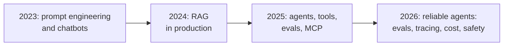

# What AI engineers do, and what employers ask for

LinkedIn's *Jobs on the Rise 2025* report ranked **AI engineer as the fastest-growing job** in the US. The title covers several jobs, so look at what the postings require.

## What 895 job posts asked for

Alexey Grigorev's [AI Engineering Field Guide](https://github.com/alexeygrigorev/ai-engineering-field-guide) analysed **895 "AI Engineer" postings from 590 companies** (builtin.com; Los Angeles, New York, London, Amsterdam and Berlin; collected in early February 2026). 69% were *AI-first* roles (building AI products), 29% *AI-support* roles.

| Skill | Share or count of postings |
|---|---|
| Python | 82.5% |
| RAG | 35.9% (the most common GenAI pattern) |
| Prompt engineering | 29.1% |
| LLMs (named explicitly) | 25.4% |
| TypeScript | 23.4% |
| LangChain | 18.8% |
| Agents | 14.4% |
| Cloud: AWS / Azure / GCP | 359 / 214 / 205 postings |
| Docker / CI/CD / Kubernetes | 277 / 262 / 260 postings |
| PyTorch | 197 postings |
| Vector databases | 97 postings |
| FastAPI | 96 postings |

## What that means for you

- **It's an engineering job first.** 93.1% of AI-first roles require skills beyond GenAI: Python, APIs, cloud, containers, CI/CD.
- **Evaluation is a differentiator.** 39.6% of AI-first roles explicitly ask for evaluation skills, and the guide calls evaluation the single biggest differentiator in take-home assignments.
- **Some ML is expected.** 64.3% of AI-first roles ask for some ML knowledge; fine-tuning appears in 30.8% but is a primary responsibility in only 4%.
- **Frameworks come and go.** Learn the concepts (retrieval, tools, evals), then any framework is a week's work.

These posts are from the US and Europe. Your local market may differ, which is why this module's task is to collect your own data.

## What moved in 2025 and 2026

The 895-post study is a snapshot from early 2026, and the field moves fast. The guide's job dataset keeps growing (it has passed several thousand postings), and a few shifts show in it and in interviews:

- **Agents went from rare to normal.** Agents appear in 14.4% of all posts but **33.3% of AI-first roles**, and agent frameworks (LangChain, LangGraph) are named often.
- **Evaluation and observability** moved from nice-to-have to expected in AI-first teams.
- **New standard tooling** that posts mention less often than interviews do: the **Model Context Protocol (MCP)** for connecting tools, **reasoning models**, and **context engineering**. Part 3 covers all three, so you can talk about them before the posts catch up.

## Three kinds of AI companies

Janvi Kalra's advice (quoted in the guide): sort the market into **product companies** (they use models to build products), **infrastructure companies** (tools for AI developers) and **model companies** (they train models), then target the one that excites you. Most AI engineer jobs are in the first group.

## Optional videos

The lesson above is complete on its own. These go deeper, if you like learning by watching.

**Software Is Changing (Again) (Andrej Karpathy, Y Combinator)**

https://www.youtube.com/watch?v=LCEmiRjPEtQ
