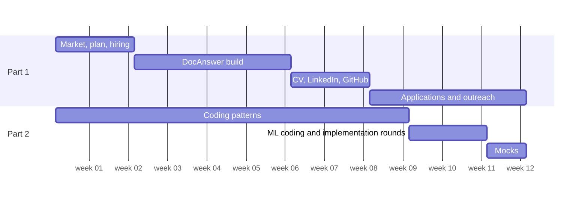

# Your skills gap and your plan

Score yourself 0 to 3 on each line (0: never used, 1: followed a tutorial, 2: built something alone, 3: could explain it in an interview and debug it under pressure). Be strict.

| Area | Skills | Where to close the gap |
|---|---|---|
| Programming | Python, Git, testing, SQL | *Python: the full course* |
| Back end | REST APIs, async, a database | *FastAPI* course |
| Shipping | Docker, CI/CD, a cloud deploy | *Docker and Kubernetes*; project steps here |
| LLM apps | prompting, structured output, tool calling, RAG | this part's project, part 3 |
| Evaluation | golden sets, retrieval metrics, LLM-as-judge | this part's project, part 3 |
| ML basics | train/test, metrics, overfitting, embeddings | *Machine learning* roadmap (optional) |
| Agents | tool calling, MCP, an agent loop with limits and approval | part 3; *LangChain and LangGraph* short course |
| Model knowledge | how LLMs work, reasoning and multimodal models, fine-tuning trade-offs | part 3; *LLMs: how they work* short course |
| Interviews | DSA patterns, system design, behavioral | parts 2 and 3; module 9 here |

## Your weekly plan

Put fixed blocks in your calendar, like a part-time job: for example 2 hours on 5 weekday evenings and a 6-hour block at the weekend. Hours you only *intend* to study don't count. Review every Friday: what got done, what slipped, what changes next week.

## A 12-week shape

The dates are only an example; the point is that applications start while you're still training, not after. Part 3 follows, or runs alongside once DocAnswer is shipped.
