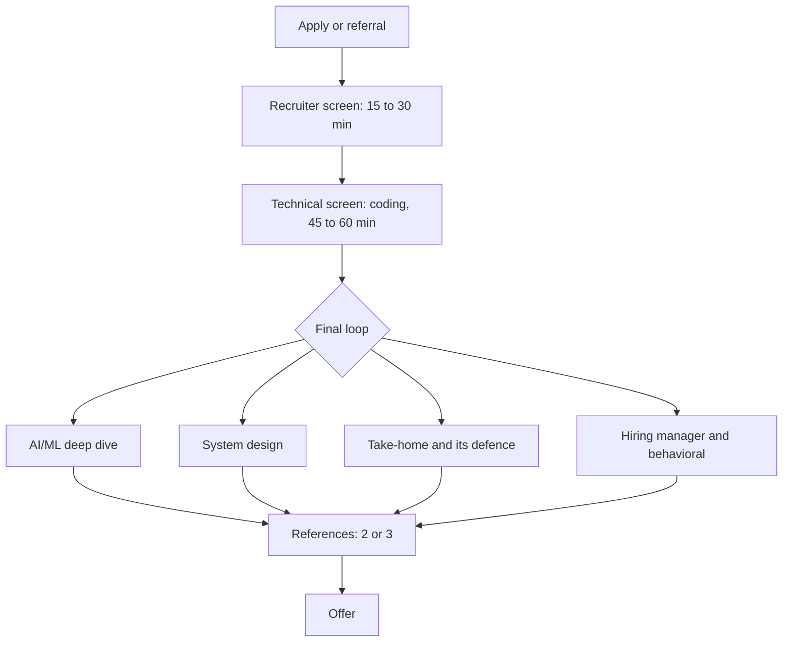

# The interview loop, stage by stage

The [field guide](https://github.com/alexeygrigorev/ai-engineering-field-guide) collected the processes companies describe and candidates report: the **median process has 4 steps** (most have 3 to 5), usually over **2 to 6 weeks**.

| Stage | Length | What it tests | Prepared in |
|---|---|---|---|
| Recruiter screen | 15 to 30 min | fit, motivation, salary expectations, logistics | module 9 |
| Technical screen | 45 to 60 min | live coding (LeetCode-style or practical) | part 2 |
| AI/ML deep dive | 45 to 90 min | LLMs, RAG, hallucinations, fine-tuning against prompting | part 3 |
| System design | about 60 min | designing an AI system; cost, latency, scale | part 3 |
| Take-home | 2 to 4 hours of work, 2 to 7 days to submit | building a RAG or agent system, then defending it | part 3 |
| Hiring manager | 45 to 60 min | depth on your projects, ownership | your project, module 9 |
| Behavioral | 30 to 60 min | values, conflict, ambiguity, STAR stories | module 9 |

Of 51 companies whose process is documented, **17 (33%) use a take-home** and 5 use paid work trials instead. Many top companies also ask for **2 to 3 references** from recent managers and colleagues: keep those relationships warm now.
