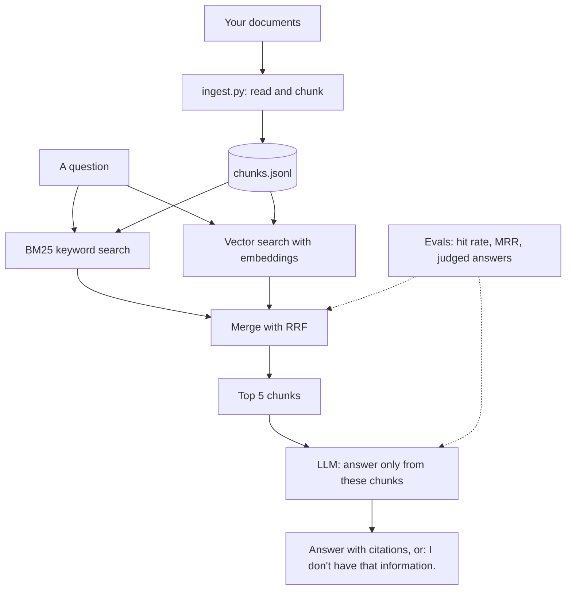

# Choose a project hiring managers care about

Your first project is **DocAnswer**: an assistant that answers questions about a real set of documents, with citations, an "I don't know" when the documents don't say, measured quality, and a public demo. It's the most requested pattern (RAG), and the field guide reports that **RAG systems are 40%+ of take-home assignments**. Building one well is direct interview practice.

## What you'll build

You'll build it in modules 3 to 6: ingest and search first, then measure retrieval, then answers and their evaluation, then the API, Docker and the demo.

## Pick documents that make it yours

Avoid the tutorial classics. Choose documents with real users and real questions, that you're allowed to use:

- your country's labour law, or a ministry's public regulations
- a university's student handbook and course rules
- an open-source project's documentation
- public company policies or product manuals in your target industry

Aim for 200 to 2,000 pages. Write down 3 real people who'd use it: you'll test with them and quote them in your README.

## What "done" means (your checklist for the next 4 modules)

- [ ] Ingestion and chunking with sources and pages
- [ ] Hybrid search, measured with hit rate and MRR on a golden set
- [ ] Answers with citations, and a refusal when the documents don't say
- [ ] Answer quality measured with an LLM judge you've checked against your own labels
- [ ] An API, tests, Docker and CI
- [ ] Deployed, with a README, an architecture diagram, the metrics and a 2-minute demo video

Arabic documents? Use a multilingual embedding model (for example `paraphrase-multilingual-MiniLM-L12-v2`) and test keyword search carefully: Arabic word forms vary a lot.
