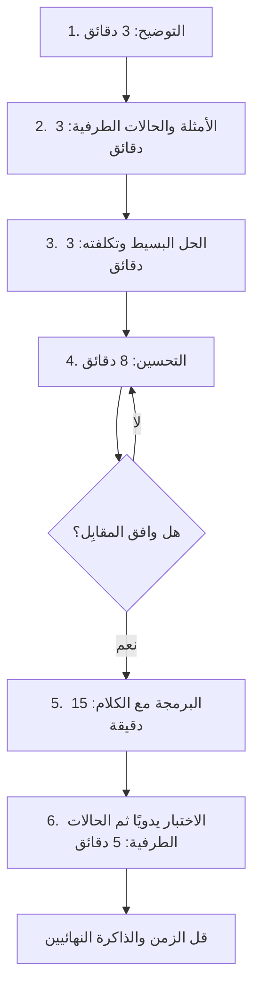

# الطريقة: ست خطوات بصوت عالٍ

استخدم الخطوات نفسها في كل مسألة تدريب حتى تصبح تلقائية. وبين القوسين توقيت تقريبي لجولة مدتها 45 دقيقة.

1. **وضّح** (3 دقائق). أعد صياغة المسألة بكلماتك. واسأل: ما حجم المدخلات؟ هل هي مرتبة؟ هل فيها أعداد سالبة أو مكررة أو مدخلات فارغة؟ وماذا نُرجع إن لم توجد إجابة؟
2. **الأمثلة** (3 دقائق). اكتب مثالًا عاديًا وحالة طرفية مع الناتج المتوقع.
3. **الحل البدائي** (3 دقائق). قل الحل البسيط وتعقيده ولو كان بطيئًا، فهو يثبت أنك فهمت.
4. **التحسين** (8 دقائق). ابحث عن عنق الزجاجة، والعمل غير الضروري، والعمل المكرر. واسأل نفسك: هل يزيله قاموس، أو الترتيب، أو مؤشران، أو كومة (heap)؟ واتفق على النهج **قبل** كتابة الكود.
5. **اكتب الكود** (15 دقيقة). أسماء واضحة، ودوال مساعدة صغيرة، وتكلّم وأنت تكتب.
6. **اختبر** (5 دقائق). مرّر مثالك على الكود سطرًا سطرًا، ثم الحالات الطرفية. وأصلح الأخطاء بهدوء. واذكر تعقيد الوقت والذاكرة النهائي.

## حين تتعثر

قل ما تفكر فيه بدل الصمت: «أبحث عن طريقة لتجنب الحلقة الداخلية، فلو خزّنت ما رأيته في مجموعة...». جرّب مثالًا أصغر بيدك. واسأل نفسك أي نمط من هذه الدورة يناسب المدخلات (مصفوفة مرتبة: بحث ثنائي أو مؤشران، و«أكبر k»: كومة، وكل التوافيق: تراجع (backtracking)، و«أقل عدد من الخطوات»: BFS). والمقابِلون يعطون التلميحات لمن يفكر بوضوح أمامهم. وتلقي التلميح مهارة أيضًا: استخدمه فورًا وابنِ عليه.
