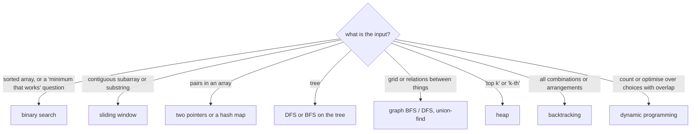

# آخر أسبوعين ويوم المقابلة

## آخر أسبوعين

- **أعِد ولا تُضِف.** أعد حل كل مسألة مكتوب عليها «احتجت مساعدة» في متتبعك. فالمسائل الجديدة تضيف قليلًا الآن، وإتقان الأنماط يضيف كثيرًا.
- إن عرفت الشركة فانظر ما يرويه المتقدمون عنها (Glassdoor، وبيانات الشركات في الدليل، ووسوم الشركات في LeetCode إن كان لديك Premium) وتدرّب على تلك الأنواع.
- جهّز قصصك السلوكية (الجزء 1) وسؤالين لكل مقابِل.
- نَم جيدًا. فالدماغ المتعب يفوّت الحالات الطرفية.

## مختار الأنماط

استخدمه حين تعيد حل المسائل: سمِّ النمط من شكل المسألة قبل أن تكتب.

## يوم المقابلة

- **عن بعد:** جرّب الكاميرا والميكروفون وأداة البرمجة (CoderPad أو HackerRank أو مستند مشترك) قبلها بيوم، وغرفة هادئة، وماء.
- **حضوريًا:** تدرّب على الورق أو السبورة مرتين على الأقل، واكتب بخط كبير، واترك مساحة لإضافة أسطر.
- **إن تجمّد ذهنك:** قل ذلك بهدوء، وعد إلى الخطوة 2 (الأمثلة)، وحلّ حالة صغيرة جدًا بيدك. فهذا وحده يعيد تشغيل تفكيرك غالبًا.
- **بعد كل جولة:** دوّن الأسئلة وكيف سارت ما دمت تتذكر. فهذه خطة مذاكرتك التالية أيًا كانت النتيجة.
