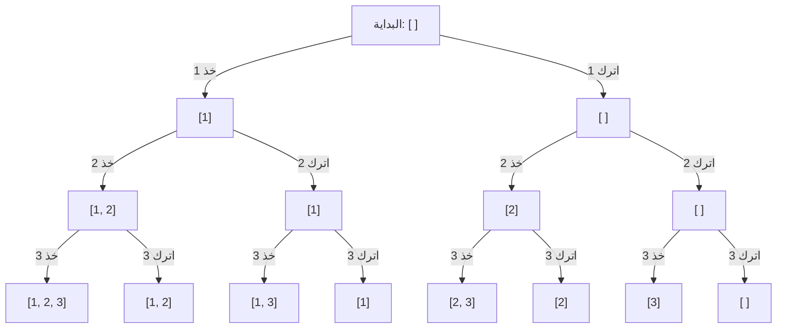

# التراجع (Backtracking)

لأسئلة «كل المجموعات الجزئية / التوافيق / التباديل / طرق الوضع»، استكشف شجرة من الاختيارات: **اختر**، ثم **استكشف**، ثم **تراجع عن الاختيار**. وتكون المدخلات صغيرة عادةً (n ≤ 20) لأن الإجابة نفسها أُسية.

```python
def subsets(nums):
    res, path = [], []

    def dfs(i):
        if i == len(nums):
            res.append(path[:])            # copy: path keeps changing
            return
        path.append(nums[i])
        dfs(i + 1)                         # with nums[i]
        path.pop()
        dfs(i + 1)                         # without it

    dfs(0)
    return res


def combination_sum(candidates, target):
    res, path = [], []

    def dfs(start, remaining):
        if remaining == 0:
            res.append(path[:])
            return
        for i in range(start, len(candidates)):
            c = candidates[i]
            if c > remaining:
                continue                   # prune
            path.append(c)
            dfs(i, remaining - c)          # i, not i + 1: a number can be reused
            path.pop()

    dfs(0, target)
    return res
```

## شجرة الاختيارات للمجموعات الجزئية من [1, 2, 3]



كل مستوى يقرر رقمًا واحدًا، وكل ورقة إجابة واحدة: 2³ = 8 مجموعات. والدالة `dfs(i)` تمشي في هذه الشجرة، و`path.pop()` هي خطوة الرجوع إلى الأعلى.

## القرارات الثلاثة

1. **ما الحالة؟** (الموضع، وما تبقى، والمسار حتى الآن)
2. **ما الخيارات في كل خطوة؟** (تأخذه أو لا، وأي رقم تالٍ، وأي خلية تالية)
3. **متى تتوقف، ومتى تقطع الفرع؟** (الوصول إلى الهدف، أو المجموع كبير جدًا، أو الخلية مزارة)

**المكرر** (Subsets II وCombination Sum II): رتّب أولًا، ثم تخطَّ `nums[i] == nums[i - 1]` حين يكون `i > start`. **الشبكات** (Word Search): علّم الخلية مزارة قبل الاستكشاف وأزل العلامة بعده.
