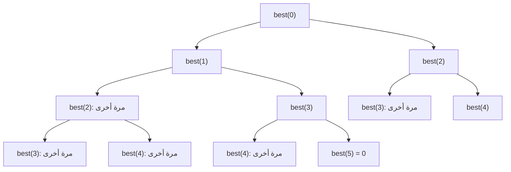

# البرمجة الديناميكية، الجزء 1

البرمجة الديناميكية (DP) عودية تتذكّر. حين تسأل المسألة عن الأفضل / عدد الطرق / هل هو ممكن، وتتكرر المسائل الفرعية نفسها، اكتبها بهذا الترتيب:

1. **الحالة:** ماذا تعني `f(i)` في جملة واحدة؟ («أكبر مبلغ من البيت i إلى النهاية»)
2. **الخيارات والانتقال:** `f(i) = max(nums[i] + f(i + 2), f(i + 1))`
3. **الحالات الأساسية:** `f(i) = 0` حين تتجاوز `i` النهاية
4. **احفظ النتائج** (من الأعلى إلى الأسفل)، ثم، إن شئت، حوّلها إلى حلقة (من الأسفل إلى الأعلى) واحتفظ بما تحتاجه فقط.

## لماذا يفيد التذكّر: استدعاءات best(0) مع 5 بيوت



دون ذاكرة تتكرر الاستدعاءات نفسها وتتضاعف الشجرة في كل مستوى: O(2ⁿ). ومع `@cache` تُحسب كل `best(i)` مرة واحدة: n حالة × عمل O(1) = O(n).

```python
from functools import cache

def rob_memo(nums):
    @cache
    def best(i):                         # most money from house i to the end
        if i >= len(nums):
            return 0
        return max(nums[i] + best(i + 2), best(i + 1))
    return best(0)


def rob(nums):                            # the same, bottom-up in O(1) memory
    prev2 = prev1 = 0
    for x in nums:
        prev2, prev1 = prev1, max(prev1, prev2 + x)
    return prev1


def coin_change(coins, amount):
    INF = amount + 1
    dp = [0] + [INF] * amount            # dp[a] = fewest coins for amount a
    for a in range(1, amount + 1):
        for c in coins:
            if c <= a:
                dp[a] = min(dp[a], dp[a - c] + 1)
    return dp[amount] if dp[amount] != INF else -1
```

في المقابلة كثيرًا ما تكفي النسخة من الأعلى إلى الأسفل، وهي أسهل في الصواب، واذكر النسخة من الأسفل إلى الأعلى وتوفيرها للذاكرة. وقل التعقيد بصيغة **عدد الحالات × العمل في كل حالة** (Coin Change: المبلغ × عدد العملات).
