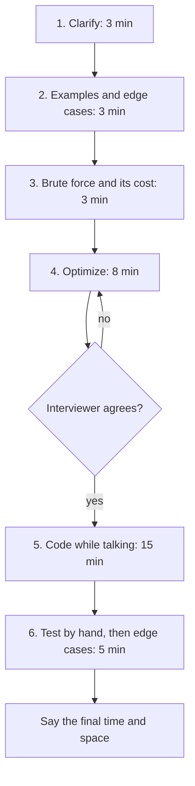

# The method: six steps, out loud

Use the same steps on every practice problem until they're automatic. For a 45-minute round, rough timings are in brackets.

1. **Clarify** (3 min). Repeat the problem in your words. Ask: input size? Sorted? Negatives, duplicates, empty input? What to return when there's no answer?
2. **Examples** (3 min). Write a normal example and an edge case, with the expected output.
3. **Brute force** (3 min). Say the simple solution and its complexity, even if it's slow. It proves you understood.
4. **Optimize** (8 min). Look for the bottleneck, unnecessary work and repeated work. Ask yourself: would a hash map, sorting, two pointers or a heap remove it? Agree on the approach **before** coding.
5. **Code** (15 min). Clear names, small helper functions, talk while you type.
6. **Test** (5 min). Run your example through the code line by line, then the edge cases. Fix bugs calmly. State the final time and space complexity.

## When you're stuck

Say what you're thinking, not nothing: "I'm looking for a way to avoid the inner loop; if I stored what I've seen in a set..." Try a smaller example by hand. Ask yourself which pattern from this course fits the input (sorted array: binary search or two pointers; "top k": heap; all combinations: backtracking; "minimum number of steps": BFS). Interviewers give hints to people who are visibly reasoning. Taking a hint well is a skill: use it immediately and build on it.
