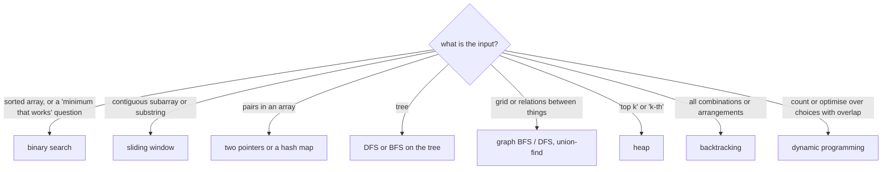

# The last two weeks and interview day

## The last two weeks

- **Redo, don't add.** Re-solve every problem marked "needed help" in your tracker. New problems now add little; fluency on the patterns adds a lot.
- If you know the company, look at what candidates report for it (Glassdoor, the field guide's company data, LeetCode's company tags if you have Premium) and practise those types.
- Prepare your behavioral stories (part 1) and two questions to ask each interviewer.
- Sleep. Tired brains miss edge cases.

## The pattern chooser

Use it when you redo problems: name the pattern from the problem's shape before you code.

## Interview day

- **Online:** test the camera, microphone and the coding tool (CoderPad, HackerRank, a shared doc) the day before; a quiet room; water.
- **In person:** practise on paper or a whiteboard at least twice; write big, leave space to insert lines.
- **If you blank:** say so calmly, go back to step 2 (examples) and solve a tiny case by hand. That alone usually restarts your thinking.
- **After each round:** write down the questions and how it went, while you remember. That's your next study plan, whatever the result.
