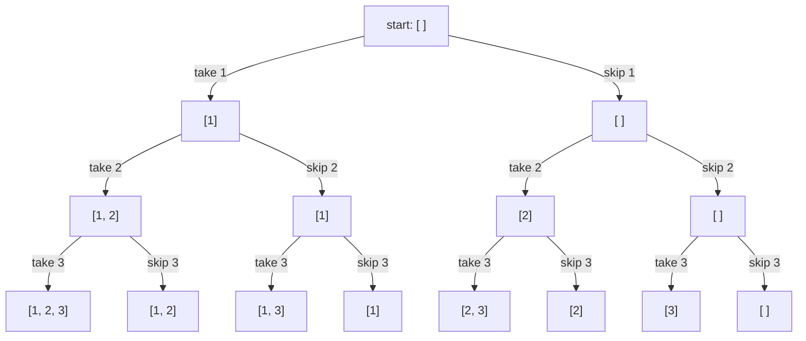

# Backtracking

For "all subsets / combinations / permutations / ways to place", explore a tree of choices: **choose**, **explore**, **un-choose**. The input is usually small (n ≤ 20) because the answer itself is exponential.

```python
def subsets(nums):
    res, path = [], []

    def dfs(i):
        if i == len(nums):
            res.append(path[:])            # copy: path keeps changing
            return
        path.append(nums[i])
        dfs(i + 1)                         # with nums[i]
        path.pop()
        dfs(i + 1)                         # without it

    dfs(0)
    return res


def combination_sum(candidates, target):
    res, path = [], []

    def dfs(start, remaining):
        if remaining == 0:
            res.append(path[:])
            return
        for i in range(start, len(candidates)):
            c = candidates[i]
            if c > remaining:
                continue                   # prune
            path.append(c)
            dfs(i, remaining - c)          # i, not i + 1: a number can be reused
            path.pop()

    dfs(0, target)
    return res
```

## The tree of choices for subsets of [1, 2, 3]



Each level decides one number; each leaf is one answer: 2³ = 8 subsets. `dfs(i)` walks this tree, and `path.pop()` is the step back up.

## The three decisions

1. **What's the state?** (the index, what's left, the path so far)
2. **What are the choices at each step?** (take it or not; which next number; which next cell)
3. **When do you stop, and when do you prune?** (the target reached; the sum too big; the cell visited)

**Duplicates** (Subsets II, Combination Sum II): sort first, then skip `nums[i] == nums[i - 1]` when `i > start`. **Grids** (Word Search): mark the cell visited before exploring and unmark it after.
