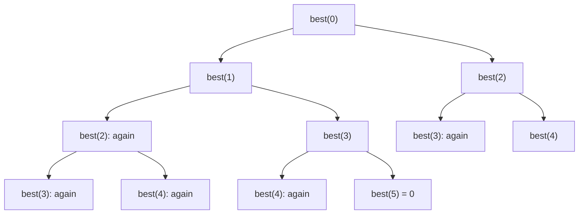

# Dynamic programming, part 1

DP is recursion that remembers. When a problem asks for the best / the number of ways / whether it's possible, and the same subproblems repeat, write it in this order:

1. **State:** what does `f(i)` mean, in one sentence? ("the most money from house i to the end")
2. **Choices and transition:** `f(i) = max(nums[i] + f(i + 2), f(i + 1))`
3. **Base cases:** `f(i) = 0` when `i` is past the end
4. **Memoize** it (top-down), then, if you want, turn it into a loop (bottom-up) and keep only what you need.

## Why remembering helps: the calls of best(0) with 5 houses



Without memory the same calls repeat and the tree doubles at every level: O(2ⁿ). With `@cache` each `best(i)` is computed once: n states × O(1) work = O(n).

```python
from functools import cache

def rob_memo(nums):
    @cache
    def best(i):                         # most money from house i to the end
        if i >= len(nums):
            return 0
        return max(nums[i] + best(i + 2), best(i + 1))
    return best(0)


def rob(nums):                            # the same, bottom-up in O(1) memory
    prev2 = prev1 = 0
    for x in nums:
        prev2, prev1 = prev1, max(prev1, prev2 + x)
    return prev1


def coin_change(coins, amount):
    INF = amount + 1
    dp = [0] + [INF] * amount            # dp[a] = fewest coins for amount a
    for a in range(1, amount + 1):
        for c in coins:
            if c <= a:
                dp[a] = min(dp[a], dp[a - c] + 1)
    return dp[amount] if dp[amount] != INF else -1
```

In an interview, the top-down version is often enough and easier to get right; mention the bottom-up version and its memory saving. Say the complexity as **number of states × work per state** (Coin Change: amount × coins).
