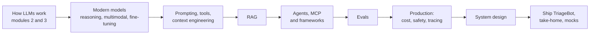

# ابدأ هنا

هذا هو الجزء 3 من *التوظيف مهندس ذكاء اصطناعي*. وهو يجهّزك للجولات الخاصة بوظائف الذكاء الاصطناعي، ويبني مشروعك الكبير الثاني:

- **التعمق في AI/ML** (من 45 إلى 90 دقيقة): كيف تعمل الـ LLMs، والـ reasoning models والنماذج متعددة الوسائط (multimodal)، والـ RAG، والـ agents، والـ MCP، والتقييم (evals)، والتكلفة، والأمان، والـ fine-tuning.
- **تصميم أنظمة الذكاء الاصطناعي** (نحو 60 دقيقة): صمّم chatbot، ونظام أسئلة وأجوبة على المستندات، وسير عمل لـ agent، على نطاق كبير.
- **المهمة المنزلية (take-home) والدفاع عنها**: ابنِ نظام RAG أو agent في ساعات قليلة، ثم اشرح كل قرار.
- **مشروع TriageBot**: agent لتذاكر الدعم الفني بأدوات وحواجز أمان (guardrails) وتتبع (tracing) وتقييمات وموافقة بشرية، تبنيه خطوة بخطوة في الوحدات من 5 إلى 9.

## كيف تجيب عن سؤال نظري

يريد المحاورون الفهم، لا التعريفات. استخدم أربع خطوات:

1. **ما هو**، في جملة واحدة.
2. **كيف يعمل**: الآلية.
3. **الموازنات (trade-offs)**: متى يفشل، وكم يكلّف.
4. **تجربتك**: «في DocAnswer قِست...».

مثال لسؤال *«ما هو الـ KV cache؟»*: «يخزّن الـ keys والـ values الخاصة بالـ attention للرموز (tokens) التي عولجت (ما هو). فكل token جديد يحسب الـ keys والـ values الخاصة به فقط، وينظر إلى المخزّن، فلا يعيد التوليد حساب البداية كلها (كيف). وهذا يسرّع التوليد، لكنه يستهلك ذاكرة GPU تكبر مع طول السياق وعدد الطلبات معًا، وهذا يحدّ عدد المستخدمين على GPU واحد (الموازنة). وفي TriageBot، جعلت سلاسل التذاكر الطويلة زمن أول token يقفز، فقلّمت السجل (التجربة).»

قوائم الأسئلة في هذا الجزء مأخوذة من مجموعة أسئلة المقابلات الحقيقية في [الدليل](https://github.com/alexeygrigorev/ai-engineering-field-guide)، مع موضوعات صارت أساسية في 2025 و2026: الـ reasoning models، والـ MCP، وهندسة السياق (context engineering)، وأطر الـ agents.

**المتطلبات:** الجزء 1 (ستعيد استخدام بحث DocAnswer) وعادات الجزء 2. وخطط لنحو 8 ساعات أسبوعيًا لمدة 12 أسبوعًا. كل درس يعمل بلا إنترنت، والفيديوهات في نهاية بعض الدروس إضافات اختيارية.
