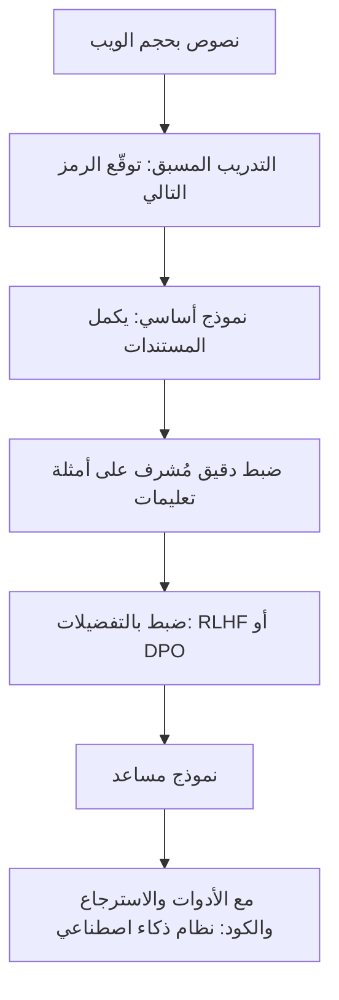

# الصورة الكبيرة: كيف يُصنع نموذج لغوي مساعد

النموذج اللغوي الكبير، ماديًا، شيئان: ملف كبير من **المعاملات** (أرقام تُتعلَّم في التدريب) وبرنامج صغير يشغّلها. وكل ما هو مهم يكمن في كيفية صنع تلك الأرقام.

> **فيديو اختياري في الأعلى.** محاضرة أندريه كارباثي *Intro to Large Language Models* (ساعة واحدة)، ويلخّصها هذا الدرس. كل ما تحتاجه موجود في النص أدناه، فشاهده فقط إن كان يفيدك: يحفظ inPace المكان الذي توقفت عنده.
>
> الفيديو بالإنجليزية: إن أردت مشاهدته فشغّل الترجمة (**CC**)، ثم **الإعدادات ← الترجمة ← ترجمة تلقائية ← العربية**.

## المراحل

1. **التدريب المسبق.** يقرأ النموذج كمية هائلة من النصوص ويتعلم توقّع الرمز التالي. ولكي يجيد ذلك عليه أن يستوعب القواعد والحقائق وأنماط الاستدلال، مضغوطةً (ضغطًا يفقد شيئًا) في معاملاته. وهذه المرحلة المكلفة: مجموعات GPU كبيرة لأسابيع أو أشهر. والناتج **نموذج أساسي** يكمل المستندات ولا يتبع التعليمات.
2. **الضبط الدقيق ليصبح مساعدًا.** يُدرَّب النموذج الأساسي أكثر على أمثلة محادثات كثيرة بصيغة *سؤال ← إجابة مثالية* يكتبها البشر أو يراجعونها. فيصبح يجيب بدل أن يكمل النص.
3. **الضبط بالتفضيلات.** يقارن البشر الإجابات، ويتعلم النموذج تفضيل الأفضل منها (RLHF أو DPO). وهنا تتشكل الفائدة والنبرة والرفض.

## ماذا يعني هذا لعملك

- يعرف النموذج **ما كان في بيانات تدريبه** حتى تاريخ معين. أما مستنداتك والحقائق الحديثة فيجب أن تأتي عبر السياق (RAG والأدوات).
- إنه **يتوقع نصًا معقولًا**، فقد يخطئ بثقة (الهلوسة): فاربطه بالمصادر وقيّمه.
- صار مركز نظام أكبر يستخدم **الأدوات**: البحث، والكود، والحاسبات، ونماذج أخرى. وهذا النظام، لا النموذج وحده، هو ما يبنيه مهندسو الذكاء الاصطناعي.
- وتأتي معه **مشكلات أمنية جديدة**: كسر القيود (إقناع النموذج بترك قواعده)، وحقن الأوامر (تعليمات مخفية في البيانات التي يقرؤها)، وتسميم البيانات (بيانات سيئة في التدريب أو في فهرسك).
