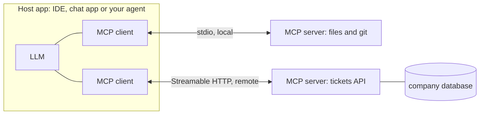

# الـ MCP: بروتوكول واحد للأدوات والسياق

قبل 2025 كان كل تطبيق يوصل أدواته بنموذجه بطريقته: M تطبيقًا في N أداة تساوي M×N تكاملًا مخصصًا. و**بروتوكول سياق النماذج (Model Context Protocol, MCP)**، الذي أطلقته Anthropic معيارًا مفتوحًا في نوفمبر 2024، يحوّل ذلك إلى M+N: مزوّد الأداة يكتب **MCP server** واحدًا، وأي تطبيق فيه **MCP client** يستطيع استخدامه. وتبنّته OpenAI وGoogle وMicrosoft وأغلب أطر الـ agents وبيئات التطوير في 2025، وفي ديسمبر 2025 تبرعت به Anthropic لمؤسسة Agentic AI Foundation الجديدة تحت Linux Foundation.



## القطع

| القطعة | من يقرر استخدامها | مثال |
|---|---|---|
| **Tools** | النموذج | `get_ticket(ticket_id)` |
| **Resources** | التطبيق (سياق للقراءة فقط) | `tickets://open`، ملف، مخطط |
| **Prompts** | المستخدم (قوالب قابلة لإعادة الاستخدام) | «لخّص سلسلة هذه التذكرة» |

الرسائل بصيغة JSON-RPC. والخوادم المحلية تعمل عادة عبر **stdio** (يشغّل التطبيقُ المضيف الخادمَ كعملية)، والخوادم البعيدة تستخدم **Streamable HTTP** مع OAuth لتسجيل الدخول.

## خادم صغير

بالـ SDK الرسمي لبايثون (الإصدار 2، ‏`pip install mcp`؛ والدروس الأقدم تستخدم الإصدار 1 حيث كان اسم الكلاس `FastMCP`):

```python
from mcp.server.mcpserver import MCPServer

server = MCPServer("tickets")
TICKETS = {"T-1": {"status": "open", "subject": "Refund not received"}}

@server.tool()
def get_ticket(ticket_id: str) -> dict:
    """Return one support ticket by its id, for example T-1."""
    return TICKETS.get(ticket_id, {"error": "not found"})

@server.resource("tickets://open")
def open_tickets() -> str:
    """The ids of all open tickets, one per line."""
    return "\n".join(k for k, v in TICKETS.items() if v["status"] == "open")

if __name__ == "__main__":
    server.run()  # stdio: a host app launches this file and talks to it
```

يحوّل الـ SDK الـ type hints والـ docstring إلى مخطط JSON للأداة ووصفها، ولهذا يجب أن يكون الاثنان واضحين.

## ما يسأله المحاورون

- **الـ MCP مقابل function calling العادي؟** الـ function calling هو كيف يطلب نموذج واحد أداة داخل تطبيق واحد. والـ MCP هو كيف تُحزم الأدوات وتُكتشف ليعيد استخدامها تطبيقات كثيرة. والـ MCP client يحوّل أدوات الـ MCP إلى function calls لنموذجه في النهاية.
- **الأمان؟** الـ MCP server كود يعمل بصلاحياتك. ثبّت الخوادم الموثوقة فقط، وأعطِ كلًّا منها أقل صلاحية يحتاجها، واطلب موافقة لعمليات الكتابة، وتذكّر أن أوصاف الأدوات ونتائجها قد تحمل prompt injection ‏(«tool poisoning»).
- **A2A؟** بروتوكول Agent2Agent من Google ‏(2025) لتواصل الـ agents مع *agents أخرى*، أما الـ MCP فلوصول الـ agent إلى الأدوات والبيانات. وهما يكمّلان بعضهما.

## فيديوهات اختيارية

الدرس أعلاه كامل وحده. هذه الفيديوهات للتعمق إن كنت تحب التعلم بالمشاهدة. الفيديوهات بالإنجليزية: إن أردت فشغّل الترجمة (**CC**)، ثم **الإعدادات ← الترجمة ← ترجمة تلقائية ← العربية**.

**The Model Context Protocol (MCP) (Anthropic)**

https://www.youtube.com/watch?v=CQywdSdi5iA
