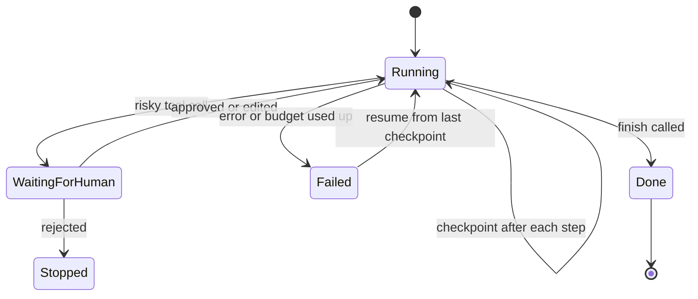

# أنظمة متعددة الـ agents والـ agents طويلة التشغيل

## تعدد الـ agents: صندوق إضافي ليس مجانيًا

سؤال تصميم شائع: «هل ستستخدم عدة agents؟». والإجابة الصادقة غالبًا: «فقط لسبب أستطيع تسميته»:

| النمط | كيف يعمل | مناسب لـ |
|---|---|---|
| **Supervisor** | agent واحد يوزع العمل على agents متخصصة ويجمع النتائج | مهارات منفصلة بوضوح (الفواتير مقابل الدعم التقني) |
| **Sub-agents للعزل** | agent رئيسي يطلق عمّالًا بسياقات نظيفة، ويُرجع كلٌّ منهم ملخصًا قصيرًا | مهام بحث أو برمجة كبيرة ستفيض عن سياق واحد |
| **Handoffs** | الـ agent النشط يسلّم المحادثة لـ agent آخر | مسارات خدمة العملاء |

التكاليف: tokens أكثر (أنظمة البحث متعددة الـ agents قد تستهلك أضعاف tokens المحادثة العادية)، وزمن أطول، وأخطاء تنتقل بين الـ agents. وذكرت Anthropic في وصفها لنظام البحث متعدد الـ agents ‏(2025) مكاسب كبيرة في أسئلة البحث الواسعة، وذكرت أيضًا أن أغلب مهام البرمجة تناسب agent واحدًا أكثر، لأن أجزاءها تعتمد على بعضها.

## الـ agents طويلة التشغيل

الـ agents التي تعمل دقائق أو ساعات تحتاج ما يحتاجه أي عمل طويل:

- **Checkpoints** بعد كل خطوة، فيستأنف الانهيار أو النشر الجديد بدل البدء من جديد (checkpointers في LangGraph، أو محرك سير عمل دائم مثل Temporal).
- **Interrupts** للموافقة البشرية تنتظر ساعات دون أن تحجز thread على الخادم.
- **ميزانيات:** حد أقصى للخطوات والـ tokens والمال والوقت.
- **أدوات idempotent**، فلا تستطيع خطوة مستأنفة إرسال البريد نفسه مرتين.
- **ملاحظات تقدّم** يكتبها الـ agent لنفسه، فلا يضيع الخطة سياقٌ مُلخَّص.

## أسئلة للتدريب

*متى ستقسم agent واحدًا إلى عدة agents؟ كيف تستأنف agent بعد انهيار؟ كيف تختبر agent يعمل ساعة؟*
