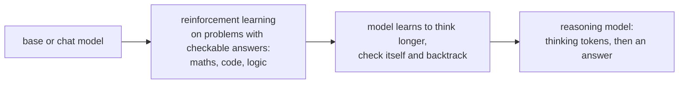

# الـ reasoning models والـ test-time compute

منذ o1 من OpenAI ‏(سبتمبر 2024) وDeepSeek-R1 ‏(يناير 2025)، يقدّم أغلب المزوّدين **reasoning models**: نماذج تكتب سلسلة تفكير طويلة قبل أن تجيب. والفكرة هي **test-time compute**: بدل أن تكبر النموذج في التدريب فقط، دعه ينفق tokens أكثر في التفكير على الأسئلة الصعبة.

## كيف تُصنع، بعمق المقابلة

أظهرت ورقة DeepSeek-R1 أن **التعلم المعزز بمكافآت قابلة للتحقق (reinforcement learning with verifiable rewards)**، أي الإجابة صحيحة أو خاطئة، والاختبارات تنجح أو تفشل، يستطيع أن يعلّم تفكيرًا طويلًا يصحح نفسه، باستخدام خوارزمية اسمها GRPO. ثم يمكن **تقطير (distill)** نماذج أصغر من مسارات تفكير نموذج كبير.

## متى تستخدمها

| استخدم reasoning model | استخدم نموذجًا عاديًا |
|---|---|
| رياضيات متعددة الخطوات، وتخطيط، وكود صعب، وتحليل معقد | استخراج، وتصنيف، وإجابات قصيرة، ومحادثة |
| agents يجب أن تخطط قبل أن تتصرف | مسارات كثيفة الطلبات بزمن قصير |
| حين تستحق الدقة ثوانيَ ودولارات | حين تكون الإجابة في السياق غالبًا (RAG) |

## موازنات قلها بصوت عالٍ

- **التكلفة والزمن:** tokens التفكير تُحاسب كمخرجات، وقد تكون آلافًا لكل سؤال. وتسمح كثير من الواجهات البرمجية بتحديد ميزانية للتفكير أو مستوى جهد.
- **الـ prompting يتغير:** أعطِ الهدف والقيود، لا تعليمات خطوة بخطوة، و«فكّر خطوة بخطوة» تضيف قليلًا لنموذج يفعل ذلك أصلًا.
- **قيّم لكل مهمة:** قد يكون الـ reasoning model أبطأ *وليس* أفضل في المهام السهلة. وجّه حسب الصعوبة وقِس.
- **التفكير الظاهر ليس دليلًا:** المكتوب لا يعكس دائمًا ما قاد الإجابة، فلا تستخدمه شرحًا للمستخدمين ولا ضمانًا للأمان.

## أسئلة للتدريب

*ما الـ test-time compute؟ كيف دُرّبت الـ reasoning models؟ متى لا تستخدم واحدًا؟ كيف تتحكم في التكلفة في نظام يستخدمها؟*

## فيديوهات اختيارية

الدرس أعلاه كامل وحده. هذه الفيديوهات للتعمق إن كنت تحب التعلم بالمشاهدة. الفيديوهات بالإنجليزية: إن أردت فشغّل الترجمة (**CC**)، ثم **الإعدادات ← الترجمة ← ترجمة تلقائية ← العربية**.

**Deep Dive into LLMs like ChatGPT (Andrej Karpathy, 3.5 hours)**

https://www.youtube.com/watch?v=7xTGNNLPyMI
