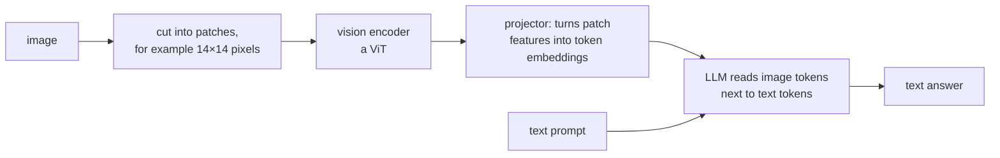

# النماذج متعددة الوسائط (multimodal): الصور والمستندات والصوت

أغلب النماذج المتقدمة تقبل الآن الصور (وغالبًا الصوت أو الفيديو) مع النص. ويستخدم مهندسو الذكاء الاصطناعي هذا يوميًا: قراءة الفواتير ولقطات الشاشة، ووصف الصور، والإجابة عن أسئلة حول الرسوم البيانية، والمساعدات الصوتية.

## كيف تدخل الصورة إلى الـ LLM

تصبح الصورة مئات أو آلاف الـ tokens حسب حجمها. ولهذا **حجم الصورة يحدد التكلفة والزمن**: صغّرها إلى ما تحتاجه المهمة.

## أفكار أساسية

- **embeddings على طريقة CLIP** تضع الصور والنصوص في فضاء متجهات واحد (درّبته OpenAI في CLIP ‏(2021) بمطابقة 400 مليون زوج من الصور وتعليقاتها). استخدمها للبحث في الصور، وإزالة التكرار، والتصنيف دون تدريب (zero-shot) مثل «صورة طرد تالف».
- **فهم المستندات:** تستطيع الـ vision-language models قراءة ملفات PDF الممسوحة والجداول والنماذج مباشرة. قارنها بالـ OCR التقليدي مع تحليل التخطيط على مستنداتك: الـ VLMs تتعامل جيدًا مع التخطيطات الفوضوية لكنها قد تخطئ في قراءة الأرقام، وتكلّف أكثر لكل صفحة.
- **الصوت:** تحويل الكلام إلى نص ثم LLM، أو نماذج كلام إلى كلام للصوت الفوري. وأهداف الزمن للصوت ضيقة (أقل بكثير من ثانية لبدء الرد يبدو طبيعيًا).

## ماذا تقول عن الجودة والأمان

- قيّم لكل حقل («مطابقة تامة لإجمالي الفاتورة على 200 فاتورة»)، لا بالعين.
- الصور قد تحمل **prompt injection** أيضًا (نص مكتوب داخل الصورة)، فعاملها كمدخلات غير موثوقة.
- البيانات الشخصية في الصور (الوجوه، والهويات) لها قواعد الخصوصية نفسها كالنص.

الدورة القصيرة *Computer vision: from pixels to modern models* ‏(بالإنجليزية) تشرح كيف تعمل نماذج الرؤية، من الـ convolutions إلى ViT وCLIP.

## أسئلة للتدريب

*كيف يقرأ الـ vision-language model صورة؟ كيف ستستخرج الحقول من 10,000 فاتورة ممسوحة شهريًا، وكيف ستتحقق من الدقة؟ متى تختار OCR بدل VLM؟*

## فيديوهات اختيارية

الدرس أعلاه كامل وحده. هذه الفيديوهات للتعمق إن كنت تحب التعلم بالمشاهدة. الفيديوهات بالإنجليزية: إن أردت فشغّل الترجمة (**CC**)، ثم **الإعدادات ← الترجمة ← ترجمة تلقائية ← العربية**.

**An Image is Worth 16x16 Words: ViT paper explained (Yannic Kilcher)**

https://www.youtube.com/watch?v=TrdevFK_am4

**OpenAI CLIP: connecting text and images (Yannic Kilcher)**

https://www.youtube.com/watch?v=T9XSU0pKX2E
