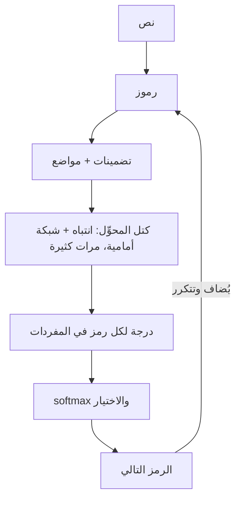

# من الرموز إلى النص

الإجابات التي يتوقعها المقابِلون بالترتيب:

1. **الترميز (Tokenization).** يُقسَّم النص إلى رموز (أجزاء كلمات) بمفردات مُتعلَّمة، غالبًا بترميز أزواج البايتات (BPE): تُدمج أزواج الحروف الشائعة مرة بعد مرة. فتصبح الكلمات النادرة عدة رموز، وكثيرًا ما تستهلك العربية رموزًا أكثر من الإنجليزية للمعنى نفسه، وهذا يكلّف مالًا وسياقًا.
2. **التضمينات.** يصبح كل رمز متجهًا، وتُضاف معلومات الموضع (تستخدم النماذج الحديثة غالبًا التضمينات الدوّارة RoPE).
3. **كتل المحوِّل (Transformer).** في كل كتلة **انتباه ذاتي** (كل رمز يجمع معلومات من الرموز السابقة بأوزان بحسب صلتها) وشبكة أمامية، مع وصلات متبقية وتطبيع.
4. **توقّع الرمز التالي.** تعطي الطبقة الأخيرة درجة لكل رمز في المفردات، وتحوّلها softmax إلى احتمالات، ويُختار رمز ويُضاف، وتتكرر الحلقة.

> **فيديو اختياري في الأعلى.** فيديو 3Blue1Brown *Attention in transformers, step by step* (26 دقيقة)، نسخة مرئية للخطوة 3. كل ما تحتاجه موجود في النص أدناه، فشاهده فقط إن كان يفيدك: يحفظ inPace المكان الذي توقفت عنده.
>
> الفيديو بالإنجليزية: إن أردت مشاهدته فشغّل الترجمة (**CC**)، ثم **الإعدادات ← الترجمة ← ترجمة تلقائية ← العربية**.

## الانتباه في فقرة واحدة

يصنع كل رمز ثلاثة متجهات: **استعلامًا** (عمّ أبحث؟)، و**مفتاحًا** (ماذا أحتوي؟)، و**قيمة** (ماذا أمرّر؟). ويُقارَن استعلام الرمز بمفتاح كل رمز سابق (ضرب نقطي مقسوم على الجذر التربيعي لحجم المتجه)، ويُخفي **القناع** الرموز المستقبلية، وتحوّل softmax الدرجات إلى أوزان، ويصبح المتجه الجديد للرمز المجموع الموزون للقيم. و**الرؤوس المتعددة** تفعل ذلك بالتوازي بإسقاطات مُتعلَّمة مختلفة، فقد يتتبع رأس القواعد ويتتبع آخر الأسماء. وهذه بالضبط دالة `attention()` التي كتبتها في الجزء 2.

## المعماريات ومراحل التدريب

| النوع | استخدام نموذجي | السبب |
|---|---|---|
| مفكِّك فقط (Decoder-only) | المحادثة والتوليد (أغلب النماذج اليوم) | انتباه سببي: كل رمز يرى الماضي فقط |
| مرمِّز فقط (Encoder-only) | التضمينات والتصنيف ومعيدات الترتيب | انتباه ثنائي الاتجاه: يرى المدخل كله |
| مرمِّز ومفكِّك | الترجمة والتلخيص (على نمط T5) | يرمّز المدخل كاملًا ثم يولّد |

**مراحل التدريب:** التدريب المسبق (توقّع الرمز التالي على نصوص بحجم الويب) ← ضبط دقيق مُشرف على أمثلة تعليمات (instruction tuning) ← ضبط بالتفضيلات: يدرّب RLHF نموذج مكافأة من ترتيبات البشر ويُحسّن بالتعلم المعزز (PPO)، أما **DPO** فيتخطى نموذج المكافأة ويتعلم مباشرة من أزواج المفضّل والمرفوض.
