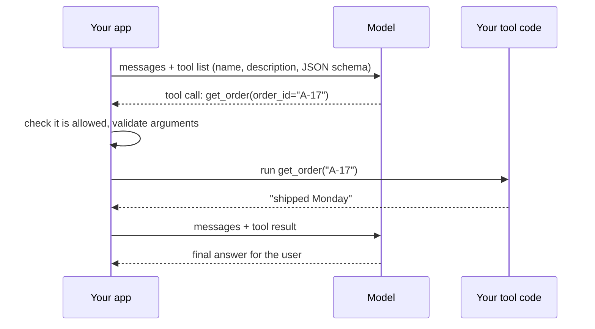

# المخرجات المنظمة واستدعاء الأدوات

نادرًا ما تريد أنظمة الإنتاج نصًا حرًا. فهي تريد **JSON يطابق مخططًا (schema)** لتخزّنه أو توجّهه أو تتحقق منه، و**استدعاءات أدوات (tool calls)** يطلب فيها النموذج من كودك أن يفعل شيئًا.

## المخرجات المنظمة (structured output)

اطلب JSON يتبع مخططًا. وكثير من الواجهات البرمجية تستطيع **فرض** مخطط JSON أثناء التوليد (يسمّى غالبًا structured outputs أو constrained decoding)، فتكون النتيجة قابلة للقراءة دائمًا. ومع ذلك تحقق منها في الكود، لأن الشكل الصحيح قد يحمل قيمًا خاطئة.

```python
from typing import Literal
from pydantic import BaseModel, Field, ValidationError

class Triage(BaseModel):
    category: Literal["billing", "shipping", "bug", "other"]
    urgent: bool
    summary: str = Field(max_length=200)

def parse(raw: str) -> Triage | None:
    try:
        return Triage.model_validate_json(raw)
    except ValidationError as err:
        # retry once: send the model its output and str(err), ask for a fix
        return None

print(parse('{"category": "shipping", "urgent": false, "summary": "Late parcel"}'))
print(parse('{"category": "weather", "urgent": false, "summary": "?"}'))
```

الاستدعاء الأول يطبع كائن `Triage`، والثاني يطبع `None`، لأن `weather` ليست فئة مسموحة. نصائح يحب المحاورون سماعها:

- ضع **التفكير قبل الإجابة** في المخطط (حقل `reason` أولًا) حين تحتاج المهمة إلى تفكير، فالنموذج يكتب بالترتيب.
- استخدم **enums** لكل ما توجّه على أساسه، فالنص الحر لا يمكن التوجيه عليه بثقة.
- اجعل المخططات صغيرة ومسطحة، فالتداخل العميق يرفع نسبة الأخطاء.

## استدعاء الأدوات (tool calling)



- تصف الأدوات بأسماء وأوصاف ومخططات JSON، فيُرجع النموذج اسم أداة ومُدخلات، و**كودك** يشغّلها ويعيد النتيجة. فالنموذج لا ينفّذ شيئًا بنفسه أبدًا.
- قد يطلب النموذج **عدة أدوات معًا** (parallel tool calls)، فشغّل المستقلة منها معًا لتوفير الوقت.
- **أوصاف الأدوات prompts أيضًا.** قل ماذا تفعل الأداة، ومتى تُستخدم، وماذا تعني المُدخلات، وماذا تُرجع. والوصف الغامض أشهر سبب لاختيار النموذج أداة خاطئة.
- أرجِع **أخطاء مفيدة** («رقم الطلب يجب أن يكون مثل A-17») بدل تتبع الأخطاء الكامل (stack trace)، فالنموذج يستطيع التعافي من خطأ واضح.
- أدوات قليلة بأسماء جيدة أفضل من أدوات كثيرة متداخلة.

## أسئلة للتدريب

*كيف تضمن أن مخرجات النموذج JSON صحيح؟ ماذا يحدث حين تفشل أداة؟ كيف تمنع النموذج من استدعاء أداة خطيرة؟ ما الفرق بين function calling والـ structured output؟* (إجابة الأخير: الـ structured output يشكّل الإجابة النهائية، أما استدعاء الأداة فطلب من كودك أن يفعل شيئًا، ثم يكمل النموذج بعده.)
