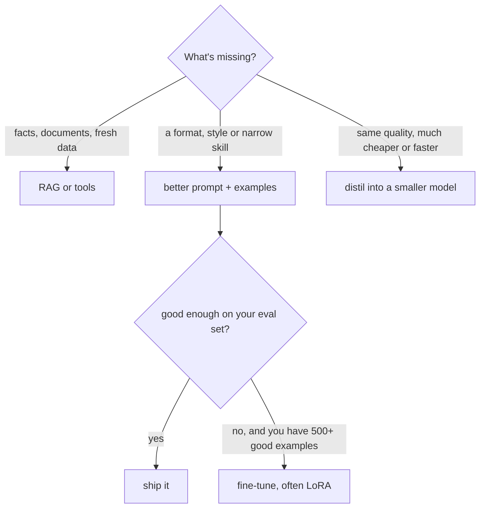

# الأوامر أم RAG أم الضبط الدقيق؟

سؤال المقابلات الكلاسيكي. أجب بما يغيّره كل منها:

| الحاجة | الأداة الأولى الأفضل | السبب |
|---|---|---|
| ينقص النموذجَ **معرفةٌ** (مستنداتك، أو حقائق حديثة) | **RAG** | تبقى الحقائق قابلة للتعديل والاستشهاد وضبط الصلاحيات |
| ينقص النموذجَ **سلوكٌ أو شكل** (أسلوب، أو مخطط، أو مهمة ضيقة) | **الأوامر** ثم **الضبط الدقيق** إن لم تكفِ | الضبط الدقيق يعلّم *كيف* لا *ماذا* |
| **التكلفة أو الزمن** مع حجم كبير | اضبط نموذجًا **أصغر** على المخرجات الجيدة للنموذج الكبير (التقطير) | أرخص لكل استدعاء متى صار جيدًا بما يكفي |

ابدأ بالأوامر، وقِس، وأضف RAG للمعرفة، ولا تضبط إلا بدليل ومجموعة تقييم جيدة. ويضبط **LoRA / PEFT** مصفوفات صغيرة مضافة بدل كل الأوزان: ذاكرة أقل بكثير، ويمكنك تبديل المحوّلات.

## أسئلة للتدريب

*متى تضبط النموذج بدل استخدام RAG؟ وما الضبط بالتعليمات؟ وما PEFT/LoRA ومتى تستخدمه؟ وكيف تحوّل تعديلات المستخدمين وقبولهم إلى إشارات تدريب؟ ومتى يكون نموذج مفتوح المصدر صغير «جيدًا بما يكفي»؟*

## قرار يمكنك رسمه

وحدة «النماذج الحديثة» تشرح كيف يعمل LoRA وQLoRA والـ preference tuning عمليًا، وكم تكلّف.
