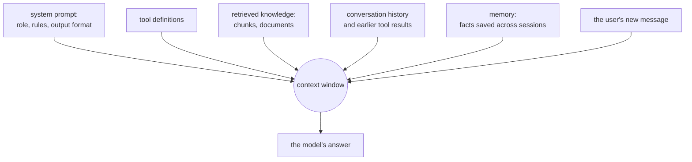

# هندسة السياق (context engineering) والـ prompt caching

**هندسة السياق** هي أن تقرر ماذا يدخل نافذة النموذج في كل استدعاء، وبأي ترتيب، وماذا يُحذف. انتشر المصطلح في 2025 لأنه حين كبرت الأنظمة لتصبح agents بأدوات وذاكرة، تبيّن أن أغلب مشكلات الجودة مشكلات سياق، لا مشكلات صياغة.

## ما الذي يتنافس على النافذة

كل شيء يكلّف tokens وانتباهًا. والنماذج تجد المعلومات في أول السياق الطويل وآخره أوثق من وسطه («lost in the middle»)، والجودة تنخفض عادة قبل امتلاء النافذة. فالسياق الأكثر ليس أفضل تلقائيًا.

## التقنيات

| التقنية | متى |
|---|---|
| **الاختيار (select):** استرجع أفضل المقاطع فقط، وحمّل الأدوات التي تحتاجها هذه الخطوة فقط | دائمًا |
| **الترتيب (order):** التعليمات الثابتة أولًا والسؤال أخيرًا، وضع الدليل الأهم قرب السؤال | دائمًا |
| **الضغط (compress):** لخّص الأدوار القديمة، واحتفظ بالجزء المفيد فقط من نتيجة الأداة | المحادثات الطويلة وحلقات الـ agents |
| **العزل (isolate):** أعطِ مهمة فرعية لـ sub-agent بسياق نظيف خاص به، ويُرجع ملخصه فقط | مهام البحث أو البرمجة الكبيرة |
| **الحفظ (persist):** اكتب ملاحظات أو ملف مهام خارج النافذة وأعد قراءته | الـ agents طويلة التشغيل |

## الـ prompt caching

يستطيع مزوّدو النماذج تخزين البداية المعالَجة من الـ prompt (الـ **prefix**) وإعادة استخدامها حين يبدأ الطلب التالي بالطريقة نفسها. والـ tokens المخزّنة أرخص وأسرع، وغالبًا بفارق كبير، فراجع قائمة أسعار مزوّدك الحالية. والقاعدة الوحيدة التي تجعله يعمل: **ضع ما لا يتغير أولًا** (prompt النظام، وتعريفات الأدوات، والمستندات المرجعية الطويلة)، وما يتغير أخيرًا (السجل والرسالة الجديدة). فتغيير حرف واحد قرب البداية يكسر الـ cache لكل ما بعده، فلا تضع الوقت الحالي أو رقم الطلب في أعلى prompt النظام.

## أسئلة للتدريب

*ما هندسة السياق، وكيف تختلف عن هندسة الـ prompts؟ صار الـ agent أسوأ بعد 30 خطوة: لماذا، وماذا ستفعل؟ كيف سترتب الـ prompt لتستفيد أقصى استفادة من الـ prompt caching؟*
