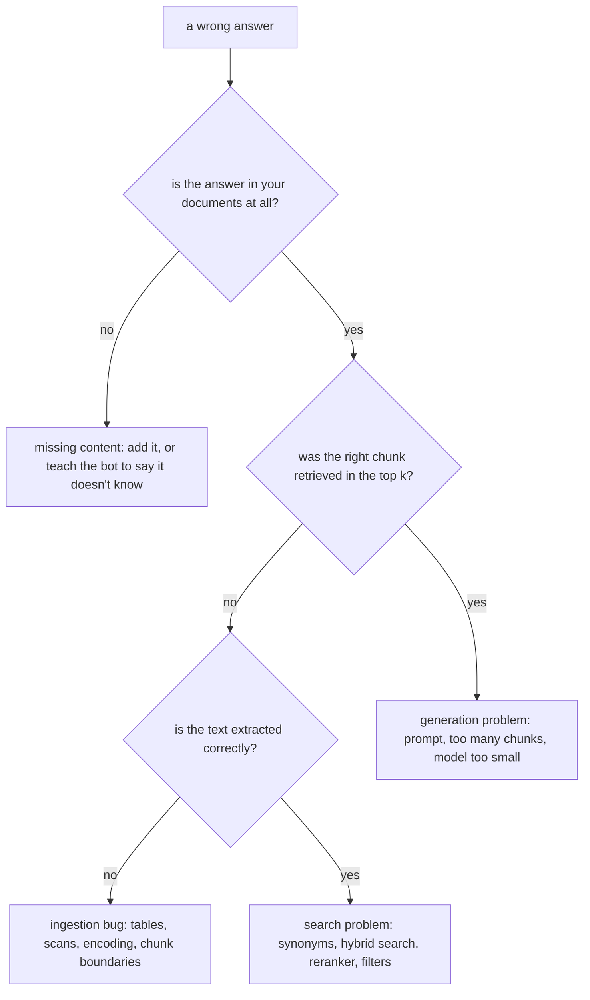

# تصحيح RAG واثق وهو مخطئ

سؤال سيناريو محبوب. امشِ فيه كتحقيق لا كتخمين:

1. **اجمع الإخفاقات:** من 20 إلى 50 إجابة سيئة حقيقية مع السؤال والقطع المسترجعة والإجابة.
2. **صنّف كلًا منها:** هل استُرجعت القطعة الصحيحة؟ إن لم تُسترجع: فمشكلة قراءة (نص ناقص أو مكسور) أو مشكلة بحث (ترتيب خاطئ، أو مرادفات، أو مرشحات). وإن استُرجعت: فمشكلة توليد (تجاهل السياق، أو خلط المصادر، أو الأمر).
3. **عُدّ الفئات** وأصلح أكبرها أولًا.
4. **أضف الإخفاقات إلى المجموعة الذهبية** كي تبقى مُصلحة.
5. **أعد تشغيل التقييمات** وقارن قبل وبعد.

وهذا هو **تحليل الأخطاء**، العادة التي يضعها خبراء التقييم مثل هامل حسين وشريا شانكار أولًا: انظر إلى البيانات قبل بناء المقاييس. وحين تقول «سأقرأ 50 إخفاقًا وأصنّفها» ستبدو كمن أطلق منتجًا فعلًا.

## مثال على العدّ

بعد قراءة 40 فشلًا لمساعد سياسات، قد تجد:

| الفئة | العدد | أول إصلاح |
|---|---|---|
| نص الجداول استُخرج سطرًا واحدًا | 14 | parser للـ PDF يفهم التخطيط (layout) |
| المقطع الصحيح في المرتبة 8 إلى 20 | 11 | أضِف reranker |
| الإجابة ليست في أي مستند | 9 | فحص «لا أملك هذه المعلومة» وطلب محتوى من الفريق |
| خلط النموذج بين سياستين | 6 | اقتباس لكل جملة، ومقاطع أقل |

هذا الجدول *هو* إجابة سؤال المقابلة: يُظهر أنك تقيس وترتب الأولويات وتصلح بالترتيب. ثم قل كيف تمنع التراجع: تنضم الحالات الأربعون إلى الـ golden set وتعمل في CI.
