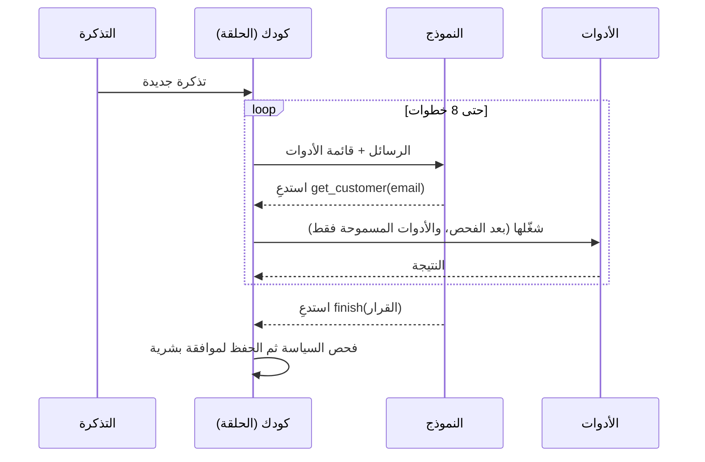

# الوكلاء: الأنماط، ومتى لا تستخدمهم

يقدّم مقال Anthropic الهندسي [Building effective agents](https://www.anthropic.com/engineering/building-effective-agents) (ديسمبر 2024) المفردات التي يستخدمها المقابِلون. وهو يفصل **سير العمل** (workflows: كودك يحدد المسار) عن **الوكلاء** (agents: النموذج يقرر خطوته التالية في حلقة مستخدمًا الأدوات والنتائج):

| النمط | ما هو | استخدمه حين |
|---|---|---|
| تسلسل الأوامر | خطوات متتالية، كل استدعاء يستخدم ناتج السابق | تنقسم المهمة إلى خطوات ثابتة |
| التوجيه | صنّف ثم أرسل إلى أمر أو نموذج متخصص | تنقسم المدخلات إلى أنواع واضحة (ويمكن إرسال السهل منها إلى نموذج صغير) |
| التوازي | عدة استدعاءات معًا ثم الدمج (أقسام أو تصويت) | أجزاء مستقلة، أو تريد عدة آراء |
| منسّق وعمّال | استدعاء يخطط للمهام الفرعية وعمّال ينفذونها | لا يمكنك معرفة المهام الفرعية مسبقًا |
| مقيّم ومحسّن | استدعاء يكتب وآخر ينتقد، في حلقة | توجد معايير جودة واضحة |
| الوكيل | النموذج يختار الأدوات في حلقة حتى ينتهي | مهام مفتوحة لا يمكن توقع خطواتها |

## الإجابات التي ترفع درجتك

- **ابدأ بالبسيط.** النصيحة الرئيسية في المقال: أبسط حل ينجح، ولا تُضاف التعقيدات إلا حين تفيد بشكل مقيس. فكثير من مسائل «الوكلاء» استدعاء واحد مع استرجاع، أو سير عمل ثابت.
- **الوكلاء يقايضون التكلفة والزمن بالمرونة**، وأخطاؤهم تتراكم عبر الخطوات.
- **التحكم في المسار مكانه الكود** لا الأوامر: حدود الخطوات، وشروط التوقف، والصلاحيات، والموافقات.
- **مكونات أبعد من النموذج:** أدوات بمخططات واضحة، وذاكرة/حالة، وحلقة بحدود، وتتبّع، وتقييمات، وضوابط.
- **أمان الأدوات:** قائمة مسموحات، وتحقق من المُدخلات، وأقل صلاحية ممكنة، وعزل (sandbox) لتشغيل الكود، وموافقة بشرية على كل ما لا يمكن التراجع عنه، وأدوات متساوية الأثر (idempotent) كي لا تكرر إعادةُ المحاولة الفعلَ مرتين.
