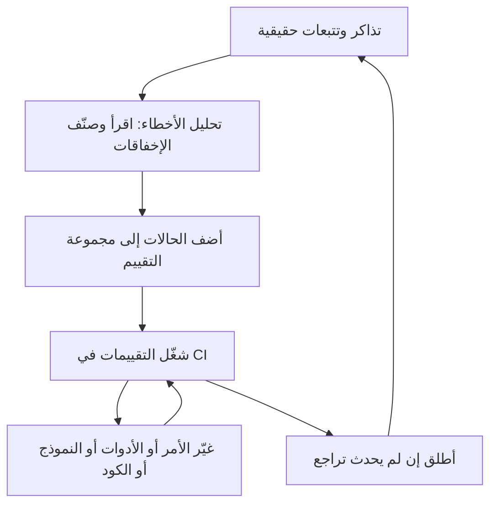

# التقييمات: المهارة التي تميّزك

وجد الدليل أن التقييم مطلوب صراحة في 39.6% من وظائف AI-first، ويصفه بأنه أكبر عامل تمييز في المهام المنزلية (قال أحد المراجعين: «علامة خطر إن لم يبدأ المتقدم بالتقييمات»). اعرف الطبقات:

| الطبقة | أمثلة | التكلفة |
|---|---|---|
| **فحوص الكود** | JSON صالح، والقيمة الصحيحة من القائمة، ووجود الإشارة، وغياب البيانات الشخصية، وأقل من N خطوة | مجانية، مع كل commit |
| **مجموعات مصنّفة** | الفئة والإجراء المتوقعان لكل تذكرة، والدقة، واستدعاء التصعيدات | رخيصة |
| **نموذج حَكَم** | فائدة الرد، والنبرة، والأمانة للمصادر، مع التحقق مقابل تصنيفات بشرية | متوسطة |
| **مراجعة بشرية** | عينة من الاستخدام الحقيقي أسبوعيًا، وقراءة التتبعات، وتصنيف الإخفاقات | مكلفة وضرورية |
| **مقاييس الإنتاج** | نسبة قبول المسودات، والتعديلات التي يجريها الموظفون، ونسبة التصعيد، وتكلفة التذكرة | من الاستخدام الحقيقي |

**مقاييس خاصة بالوكلاء:** نجاح المهمة، ودقة اختيار الأداة، والخطوات والرموز لكل مهمة، ونسبة الأفعال غير الآمنة التي مُنعت. واقرأ المزيد من الممارسين: [Your AI Product Needs Evals](https://hamel.dev/blog/posts/evals/) لهامل حسين، و[Patterns for building LLM-based systems](https://eugeneyan.com/writing/llm-patterns/) ليوجين يان.

## كيف تجعل الـ LLM-as-judge جديرًا بالثقة

الحَكَم نموذج، فيحتاج تقييمًا خاصًا به. ما ينصح به الممارسون:

- **حكم ناجح/فاشل لكل معيار** («هل تقتبس الإجابة مصدرًا؟») أفضل من درجة من 1 إلى 10: أسهل في الاتفاق عليه وفي العمل به.
- **عايره على البشر:** صنّف نحو 100 مخرج بنفسك، وشغّل الحكم، وقِس الاتفاق منفصلًا على الناجح والفاشل (كم مرة يلتقط الأخطاء الحقيقية، وكم مرة يُفشِل إجابات جيدة). حسّن prompt الحكم حتى يرتفع الاتفاق، ثم ثق به لهذا المعيار وحده.
- **اعرف تحيزاته:** يفضّل الحكام الإجابات الأطول، والخيار الأول في الزوج (position bias)، ومخرجات عائلة نموذجهم. بدّل المواضع، واستخدم نموذجًا مختلفًا كحكم حين تستطيع.
- **اكتب المعايير من أخطاء حقيقية** وجدتها في تحليل الأخطاء، لا من قائمة عامة مثل «مفيد وغير ضار».

توجد أدوات لتشغيل الـ evals ومتابعتها (مفتوحة المصدر مثل promptfoo وDeepEval وRagas وInspect، ومستضافة مثل Langfuse وLangSmith وBraintrust وArize Phoenix)، لكن قل الفكرة أولًا: «dataset له إصدارات، ومشغّل، ودرجة لكل حالة، ومقارنة بالتشغيل السابق».

## فيديوهات اختيارية

الدرس أعلاه كامل وحده. هذه الفيديوهات للتعمق إن كنت تحب التعلم بالمشاهدة. الفيديوهات بالإنجليزية: إن أردت فشغّل الترجمة (**CC**)، ثم **الإعدادات ← الترجمة ← ترجمة تلقائية ← العربية**.

**Why AI evals are the hottest new skill (Hamel Husain and Shreya Shankar, Lenny's Podcast)**

https://www.youtube.com/watch?v=BsWxPI9UM4c

**Lessons From A Year Building With LLMs (AI Engineer)**

https://www.youtube.com/watch?v=qBHfQT3YtyY
