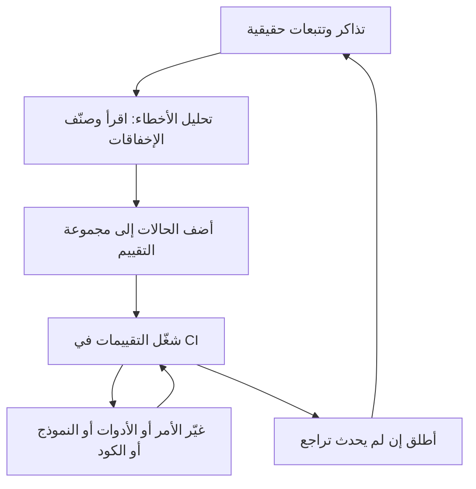

# التقييمات: المهارة التي تميّزك

وجد الدليل أن التقييم مطلوب صراحة في 39.6% من وظائف AI-first، ويصفه بأنه أكبر عامل تمييز في المهام المنزلية (قال أحد المراجعين: «علامة خطر إن لم يبدأ المتقدم بالتقييمات»). اعرف الطبقات:

| الطبقة | أمثلة | التكلفة |
|---|---|---|
| **فحوص الكود** | JSON صالح، والقيمة الصحيحة من القائمة، ووجود الإشارة، وغياب البيانات الشخصية، وأقل من N خطوة | مجانية، مع كل commit |
| **مجموعات مصنّفة** | الفئة والإجراء المتوقعان لكل تذكرة، والدقة، واستدعاء التصعيدات | رخيصة |
| **نموذج حَكَم** | فائدة الرد، والنبرة، والأمانة للمصادر، مع التحقق مقابل تصنيفات بشرية | متوسطة |
| **مراجعة بشرية** | عينة من الاستخدام الحقيقي أسبوعيًا، وقراءة التتبعات، وتصنيف الإخفاقات | مكلفة وضرورية |
| **مقاييس الإنتاج** | نسبة قبول المسودات، والتعديلات التي يجريها الموظفون، ونسبة التصعيد، وتكلفة التذكرة | من الاستخدام الحقيقي |

**مقاييس خاصة بالوكلاء:** نجاح المهمة، ودقة اختيار الأداة، والخطوات والرموز لكل مهمة، ونسبة الأفعال غير الآمنة التي مُنعت. واقرأ المزيد من الممارسين: [Your AI Product Needs Evals](https://hamel.dev/blog/posts/evals/) لهامل حسين، و[Patterns for building LLM-based systems](https://eugeneyan.com/writing/llm-patterns/) ليوجين يان.
