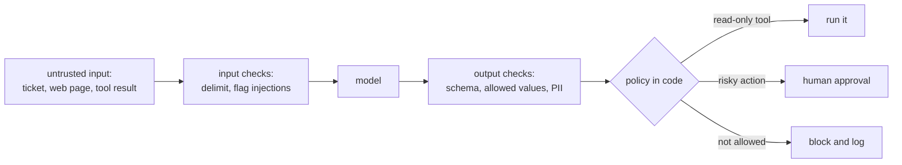

# الأمان: حقن الأوامر والبيانات الشخصية والأدوات

قائمة [OWASP Top 10 for LLM Applications 2025](https://genai.owasp.org/llm-top-10/) هي ما يتوقعه المقابِلون المهتمون بالأمان: **LLM01 حقن الأوامر، وLLM02 كشف المعلومات الحساسة، وLLM03 سلسلة التوريد، وLLM04 تسميم البيانات والنموذج، وLLM05 التعامل غير السليم مع المخرجات، وLLM06 الصلاحيات المفرطة، وLLM07 تسرب أمر النظام، وLLM08 نقاط ضعف المتجهات والتضمينات، وLLM09 المعلومات المضللة، وLLM10 الاستهلاك غير المحدود.**

## دفاعات تنجح فعلًا (على طبقات)

لا يوجد أمر يمنع الحقن تمامًا، فقيّد ما يستطيع الحقن الناجح فعله:

- عامل التذاكر والمستندات وصفحات الويب **كبيانات**: حدّدها بعلامات، وقل ذلك في أمر النظام.
- **أقل صلاحية:** أدوات للقراءة فقط افتراضيًا، ولا أداة لفعل لا رجعة فيه دون إنسان (الصلاحيات المفرطة).
- **تحقق من المخرجات** قبل استخدامها: المخططات، والقيم المسموحة، ولا تشغّل أبدًا كودًا أو SQL مولّدًا دون فحص.
- **سياسات في الكود** لا يستطيع النموذج تجاوزها.
- **احذف البيانات الشخصية** قبل التسجيل، ولا ترسل إلى النموذج بيانات شخصية أكثر مما تحتاجه المهمة.
- **الميزانيات:** حدود الخطوات والرموز والمعدل (الاستهلاك غير المحدود).
- **اختبر الهجمات** في مجموعة تقييمك مع كل commit.

## الثالوث القاتل (lethal trifecta)

اسم أطلقه Simon Willison ‏(2025) على أخطر إعداد للـ agent: agent يملك الثلاثة معًا: **وصولًا إلى بيانات خاصة**، و**تعرضًا لمحتوى غير موثوق** (رسائل بريد، وصفحات ويب، وتذاكر، ونتائج أدوات)، و**طريقة لإرسال البيانات للخارج** (بريد، وطلبات ويب، وحتى رابط صورة في markdown). ومع الثلاثة، قد تسرّب تعليمة محقونة واحدة بياناتك. فأزِل ضلعًا واحدًا على الأقل لأي مهمة لا تحتاجه.

**سؤال للتدريب:** *«الـ agent عندنا يقرأ رسائل العملاء ويستطيع إرسال رسائل. ما الذي قد يسوء، وماذا ستغيّر؟»* سمِّ الثالوث، ثم الإصلاحات: مسودات بدل الإرسال، وقائمة مسموحة من المستلمين، ولا روابط أو صور في البريد الصادر دون مراجعة، وحالات injection في مجموعة التقييم.
