# المراقبة (observability): الـ traces والمقاييس والتنبيهات

لا تستطيع إصلاح ما لا تراه، وأنظمة الـ LLM تفشل بصمت: الإجابة الأسوأ لا ترمي exception. والمراقبة هي طريقتك لتعرف.

## الـ traces

الـ **trace** سجل طلب واحد: كل خطوة فيه **span** بمدخلاتها ومخرجاتها وتوقيتها وعدد الـ tokens والتكلفة.

```mermaid
gantt
    dateFormat X
    axisFormat %L ms
    section request
    whole request          :0, 2400
    section steps
    rewrite query (small model) :0, 300
    hybrid search          :300, 420
    rerank                 :420, 650
    generate answer (stream)    :650, 2350
    check citations        :2350, 2400
```

هذا الـ trace الواحد يُظهر بنظرة أن التوليد 70% من الوقت، فالبث وتقصير السياق أهم من بحث أسرع.

**OpenTelemetry** هو المعيار المفتوح للـ traces، وله اصطلاحات (semantic conventions) للذكاء التوليدي (أسماء خصائص مثل `gen_ai.request.model` وأعداد الـ tokens)، فتذهب spans الـ LLM إلى النظام نفسه الذي يجمع بقية نظامك. وأدوات خاصة بالـ LLM ‏(Langfuse وLangSmith وArize Phoenix وHelicone وغيرها) تضيف عرض الـ prompts، ودرجات الـ evals على الـ traces، وdatasets مبنية من الاستخدام الحقيقي.

## ماذا تقيس

| النوع | أمثلة |
|---|---|
| **الصحة** | نسبة الأخطاء، وانتهاء المهلة، وزمن p50 وp95، وزمن أول token |
| **التكلفة** | الـ tokens والدولارات لكل طلب، ولكل ميزة، ولكل عميل |
| **الجودة** | درجات الـ evals على عينة من الاستخدام، ونسبة الاقتباس، ونسبة «لا أعرف»، وتقييمات المستخدمين وتعديلاتهم |
| **الأمان** | استدعاءات الأدوات المحجوبة، وإشارات الـ injection، وحجب البيانات الشخصية |
| **الـ agents** | الخطوات لكل مهمة، وأخطاء الأدوات، والمهام التي بلغت حد الخطوات |

## التنبيهات والعادة

نبّه على ما يحتاج إنسانًا الآن (نسبة الأخطاء، وقفزة التكلفة، وموجة حجب أمني)، وضع الباقي في لوحة متابعة (dashboard). واحتفظ بعادة تحليل الأخطاء: كل أسبوع، **اقرأ من 20 إلى 50 trace حقيقيًا**. فمن هناك تأتي فئات الأخطاء الجديدة.

**الخصوصية:** الـ traces تحتوي بيانات المستخدمين. احجب البيانات الشخصية قبل التخزين، وحدّد من يقرأ الـ traces، واحذفها بجدول زمني.

## أسئلة للتدريب

*ماذا ستسجّل لكل استدعاء LLM؟ يقول المستخدمون إن الإجابات ساءت الأسبوع الماضي ولا يظهر أي خطأ: كيف تحقق؟ كيف تتتبع agent عبر عدة أدوات وخدمات؟*
