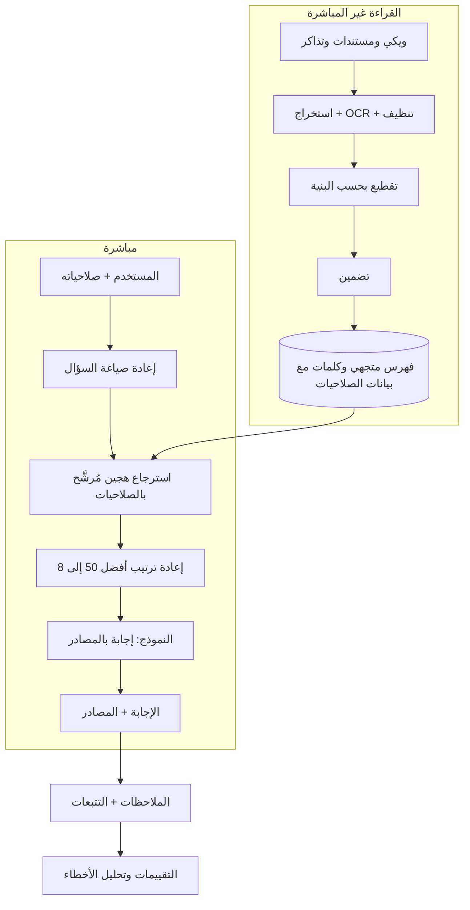

# مثال محلول: أسئلة وأجوبة على مستندات شركة كاملة

**السؤال:** *صمّم مساعدًا يجيب عن أسئلة الموظفين من 10 ملايين مستند داخلي (سياسات، وويكي، وتذاكر)، مع ضبط الصلاحيات.*

**1. التأطير.** 20 ألف موظف، وبضعة آلاف سؤال في الساعة وقت الذروة، والإجابة في أقل من 5 ثوانٍ (وأول رمز في أقل من 1.5 ثانية)، ويجب أن تذكر الإجابات مصادرها، ولا يرى المستخدمون إلا المستندات المسموح لهم بها، وتُقاس الجودة بمجموعة ذهبية لكل قسم مع الإعجاب وعدمه والتصعيد إلى البشر.

**3. التعمق.** قراءة تدريجية (المستندات المتغيرة فقط) عبر طابور، ووسوم الصلاحيات محفوظة مع كل قطعة وتُطبَّق كمرشِّح داخل البحث، وفهرس بحث تقريبي عن الأقرب (HNSW) مقسّم بحسب الأقسام، ومعيد ترتيب cross-encoder على أفضل 50، وأمر يشترط المصادر والرفض، ومجموعة تقييم لكل قسم، ولوحات لزمن p95 وتكلفة السؤال ونسبة الرفض والملاحظات.

**4. الموازنات وأنماط الفشل.** فهرس قديم مقابل تكلفة القراءة (تحديثات بالأحداث للمصادر النشطة)، وجودة معيد الترتيب مقابل 200 إلى 400 ملّي ثانية إضافية، ونموذج كبير للأسئلة الصعبة فقط (توجيه بمصنِّف)، وماذا لو تعطل مخزن المتجهات (بديل بالكلمات فقط)، وحقن الأوامر في المستندات (تحديد البيانات، ولا أدوات لها آثار جانبية)، والبيانات الشخصية في السجلات (الحذف).

**5. الختام.** تجربة مع قسم واحد، ثم القياس، ثم التوسع، والتالي: تحليل الأسئلة لاكتشاف ثغرات المحتوى.
