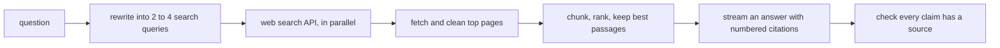

# أسئلة للتدريب

أسئلة حقيقية جمعها الدليل. أنجز واحدًا أسبوعيًا بمؤقت 45 دقيقة على سبورة أو ورق، ويفضّل مع صديق يطرح أسئلة المتابعة:

1. صمّم روبوت محادثة مثل ChatGPT أو Claude.
2. صمّم مساعد أسئلة وأجوبة على مستندات (RAG) لسياسات بنك.
3. صمّم مساعد برمجة مثل GitHub Copilot.
4. صمّم ميزة الذاكرة عبر المحادثات في ChatGPT.
5. صمّم وكيلًا متعدد الخطوات يجدول الاجتماعات من البريد.
6. صمّم نظامًا لكشف مخالفات المحتوى والسياسات.
7. صمّم محرك بحث فوري يعمل بالنماذج اللغوية مثل Perplexity.
8. وسّع ميزة محادثة بالذكاء الاصطناعي إلى مليون مستخدم يوميًا: الموازنات.
9. صمّم نظامًا يعالج 10 آلاف قسيمة راتب وهوية مرفوعة شهريًا.
10. صمّم مساعدًا صوتيًا لمستشفى (الضوضاء، والخصوصية، والزمن).

## كيف تبدأ ثلاثة منها

لن يتسع هذا الدرس للعشرة، فهذه الخطوات الأولى لثلاثة. استخدمها لتراجع محاولاتك.

**صمّم مساعد أسئلة وأجوبة لسياسات بنك (2).** اسأل: كم مستندًا، وكم مرة تتغير، ومن يقرأ ماذا، وهل قد تسبب إجابة خاطئة ضررًا قانونيًا. ثم: إدخال المستندات بتحليل التخطيط والإصدارات، وبحث hybrid مع **مرشحات الصلاحيات وقت الاسترجاع**، وإجابات باقتباس إلزامي ومسار «لا أعرف»، وgolden set يراجعه فريق الالتزام، وتسجيل بلا بيانات شخصية.

**صمّم ذاكرة عبر المحادثات مثل ChatGPT ‏(4).** اسأل: ماذا يُسمح بتذكّره، وهل يستطيع المستخدمون رؤيته وحذفه، وكيف يُستخدم. ثم: خطوة استخراج بعد المحادثات تقترح حقائق، ومخزن فيه معرّف المستخدم والحقيقة والمصدر والوقت، واسترجاع الذكريات المتعلقة في بداية المحادثة، وقواعد للموضوعات الحساسة، وevals لـ «تذكّر ما يفيد» و«لم يذكر ما لا يجب» معًا.

**صمّم محرك بحث فوري مثل Perplexity ‏(7).**

موضوعات التعمق: ميزانية الزمن لكل خطوة (البحث وجلب الصفحات هما الأبطأ، فشغّلهما بالتوازي وابدأ البث مبكرًا)، وتخزين الأسئلة الشائعة، وجودة المصادر وحداثتها، والـ injection من صفحات الويب، والتكلفة لكل إجابة.

ولكل سؤال، اختم بأهم خطرين ستراقبهما والمقياس الذي سيخبرك.
