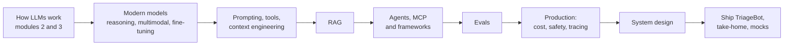

# Start here

This is part 3 of *Get hired as an AI engineer*. It prepares the rounds that are specific to AI roles, and builds your second big project:

- **The AI/ML deep dive** (45 to 90 minutes): how LLMs work, reasoning and multimodal models, RAG, agents, MCP, evaluation, cost, safety, fine-tuning.
- **AI system design** (about 60 minutes): design a chatbot, a document Q&A system, an agent workflow, at scale.
- **The take-home and its defence**: build a RAG or agent system in a few hours, then explain every decision.
- **Project TriageBot**: a support-ticket agent with tools, guardrails, tracing, evaluations and human approval, built step by step in modules 5 to 9.

## How to answer a theory question

Interviewers want understanding, not definitions. Use four beats:

1. **What it is**, in one sentence.
2. **How it works**: the mechanism.
3. **Trade-offs**: when it fails, what it costs.
4. **Your experience**: "in DocAnswer I measured...".

Example, for *"What is a KV cache?"*: "It stores the attention keys and values of tokens already processed (what). Each new token only computes its own keys and values and attends to the cached ones, so generation doesn't redo the whole prefix (how). It makes decoding fast but uses GPU memory that grows with context length and batch size, which limits how many users one GPU serves (trade-off). In TriageBot, long ticket threads made first-token latency jump, so I trimmed history (experience)."

The question lists in this part come from the [field guide](https://github.com/alexeygrigorev/ai-engineering-field-guide)'s collection of real interview questions, plus topics that became standard in 2025 and 2026: reasoning models, MCP, context engineering and agent frameworks.

**Prerequisites:** part 1 (you'll reuse DocAnswer's search) and the habits from part 2. Plan about 8 hours a week for 12 weeks. Every lesson works without internet; videos at the end of some lessons are optional extras.
