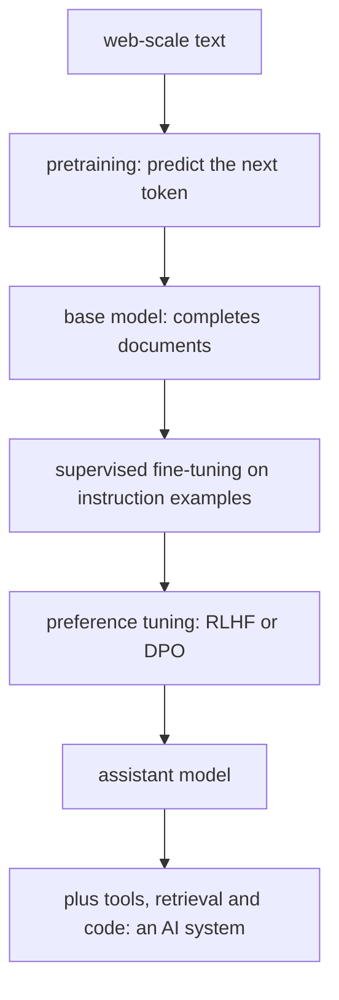

# The big picture: how an assistant LLM is made

An LLM is, physically, two things: a large file of **parameters** (numbers learned in training) and a small program that runs them. Everything interesting is in how those numbers are made.

> **Optional video above.** Andrej Karpathy's one-hour talk *Intro to Large Language Models*, which this lesson summarises. Everything you need is in the text below, so watch it only if it helps you: inPace remembers where you stopped.

## The stages

1. **Pretraining.** The model reads a huge amount of text and learns to predict the next token. To do that well it has to absorb grammar, facts and patterns of reasoning, compressed (lossily) into its parameters. This is the expensive stage: large GPU clusters for weeks or months. The result, a **base model**, continues documents; it doesn't follow instructions.
2. **Fine-tuning into an assistant.** The base model is trained further on many example conversations of the form *question → ideal answer*, written or reviewed by people. Now it answers instead of continuing text.
3. **Preference tuning.** People compare answers; the model learns to prefer the better ones (RLHF, or DPO). This is where helpfulness, tone and refusals get shaped.

## What follows for your work

- The model knows **what was in its training data**, up to a cutoff date. Your documents and fresh facts must come through the context (RAG, tools).
- It **predicts plausible text**, so it can be confidently wrong (hallucination): ground it and evaluate it.
- It's becoming the centre of a larger system that uses **tools**: search, code, calculators, other models. That system, not the model alone, is what AI engineers build.
- **New security problems** come with it: jailbreaks (talking the model out of its rules), prompt injection (instructions hidden in the data it reads) and data poisoning (bad data in training or in your index).
