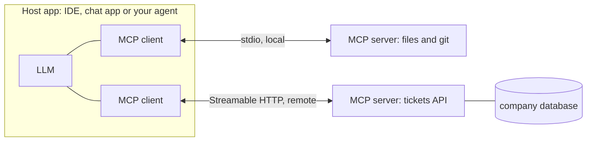

# MCP: one protocol for tools and context

Before 2025, every app wired its own tools to its own model: M apps times N tools meant M×N custom integrations. The **Model Context Protocol (MCP)**, which Anthropic released as an open standard in November 2024, turns that into M+N: a tool provider writes one **MCP server**, and any app with an **MCP client** can use it. OpenAI, Google, Microsoft and most agent frameworks and IDEs adopted it in 2025, and in December 2025 Anthropic donated it to the new Agentic AI Foundation under the Linux Foundation.



## The pieces

| Piece | Who decides to use it | Example |
|---|---|---|
| **Tools** | the model | `get_ticket(ticket_id)` |
| **Resources** | the app (read-only context) | `tickets://open`, a file, a schema |
| **Prompts** | the user (reusable templates) | "summarise this ticket thread" |

Messages are JSON-RPC. Local servers usually run over **stdio** (the host launches the server as a process); remote servers use **Streamable HTTP**, with OAuth for sign-in.

## A tiny server

With the official Python SDK (version 2, `pip install mcp`; older tutorials use version 1, where the class was called `FastMCP`):

```python
from mcp.server.mcpserver import MCPServer

server = MCPServer("tickets")
TICKETS = {"T-1": {"status": "open", "subject": "Refund not received"}}

@server.tool()
def get_ticket(ticket_id: str) -> dict:
    """Return one support ticket by its id, for example T-1."""
    return TICKETS.get(ticket_id, {"error": "not found"})

@server.resource("tickets://open")
def open_tickets() -> str:
    """The ids of all open tickets, one per line."""
    return "\n".join(k for k, v in TICKETS.items() if v["status"] == "open")

if __name__ == "__main__":
    server.run()  # stdio: a host app launches this file and talks to it
```

The SDK turns the type hints and docstring into the tool's JSON schema and description, which is why both must be clear.

## What interviewers ask

- **MCP vs plain function calling?** Function calling is how one model asks for a tool inside one app. MCP is how tools are *packaged and discovered* so many apps can reuse them. An MCP client still turns MCP tools into function calls for its model.
- **Security?** An MCP server is code with your permissions. Install only trusted servers, give each the least access it needs, require approval for writes, and remember that tool descriptions and results can carry prompt injection ("tool poisoning").
- **A2A?** Google's Agent2Agent protocol (2025) is for agents talking to *other agents*; MCP is for an agent reaching tools and data. They complement each other.

## Optional videos

The lesson above is complete on its own. These go deeper, if you like learning by watching.

**The Model Context Protocol (MCP) (Anthropic)**

https://www.youtube.com/watch?v=CQywdSdi5iA
