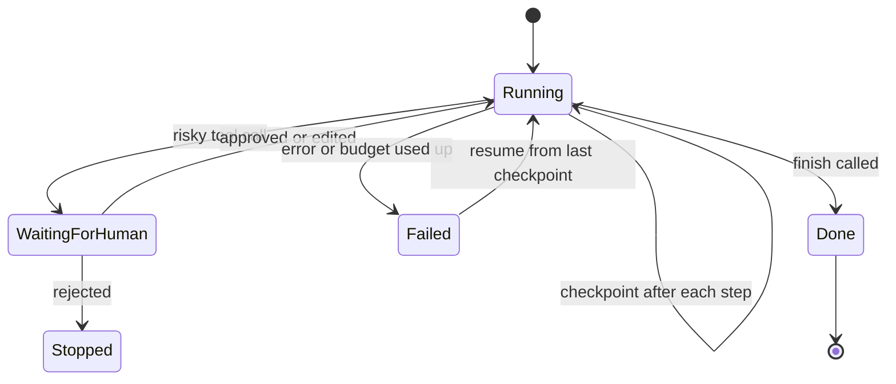

# Multi-agent systems and long-running agents

## Multi-agent: one more box isn't free

A common design question: "would you use several agents?". The honest answer is usually "only for a reason I can name":

| Pattern | How it works | Good for |
|---|---|---|
| **Supervisor** | one agent routes work to specialist agents and combines results | clearly separate skills (billing vs tech support) |
| **Sub-agents for isolation** | a lead agent spawns workers with clean contexts, each returns a short summary | big research or coding tasks that would overflow one context |
| **Handoffs** | the active agent passes the conversation to another | customer service flows |

Costs: more tokens (multi-agent research systems can use many times the tokens of one chat), more latency, and errors that pass between agents. Anthropic's write-up of its multi-agent research system (2025) reported big gains on broad research questions, and also that most coding tasks suit a single agent better because the parts depend on each other.

## Long-running agents

Agents that run for minutes or hours need what any long job needs:

- **Checkpoints** after each step, so a crash or a deploy resumes instead of restarting (LangGraph's checkpointers, or a durable workflow engine such as Temporal).
- **Interrupts** for human approval that can wait hours without holding a server thread.
- **Budgets:** maximum steps, tokens, money and wall-clock time.
- **Idempotent tools**, so a resumed step can't send the same email twice.
- **Progress notes** the agent writes for itself, so a summarised context doesn't lose the plan.

## Practice questions

*When would you split one agent into several? How do you resume an agent after a crash? How do you test an agent that runs for an hour?*
