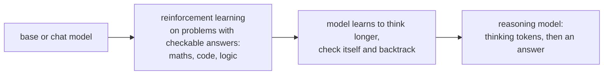

# Reasoning models and test-time compute

Since OpenAI's o1 (September 2024) and DeepSeek-R1 (January 2025), most providers offer **reasoning models**: models that write a long chain of thought before answering. The idea is **test-time compute**: instead of only making the model bigger in training, let it spend more tokens thinking on hard questions.

## How they're made, at interview depth

The DeepSeek-R1 paper showed that **reinforcement learning with verifiable rewards** (the answer is right or wrong, the tests pass or fail) can teach long, self-correcting reasoning, using an algorithm called GRPO. Smaller models can then be **distilled** from the reasoning traces of a big one.

## When to use them

| Use a reasoning model | Use a normal model |
|---|---|
| multi-step maths, planning, tricky code, hard analysis | extraction, classification, short answers, chat |
| agents that must plan before acting | high-volume, low-latency paths |
| when accuracy is worth seconds and dollars | when the answer is mostly in the context (RAG) |

## Trade-offs to say out loud

- **Cost and latency:** thinking tokens are billed as output and can be thousands per question. Many APIs let you set a thinking budget or effort level.
- **Prompting changes:** give the goal and constraints, not step-by-step instructions; "think step by step" adds little to a model that already does.
- **Evaluate per task:** a reasoning model can be slower *and* no better on easy tasks. Route by difficulty and measure.
- **Visible thinking isn't proof:** the written reasoning doesn't always reflect what drove the answer, so don't use it as an explanation for users or as a safety guarantee.

## Practice questions

*What is test-time compute? How were reasoning models trained? When would you not use one? How would you control cost in a system that uses them?*

## Optional videos

The lesson above is complete on its own. These go deeper, if you like learning by watching.

**Deep Dive into LLMs like ChatGPT (Andrej Karpathy, 3.5 hours)**

https://www.youtube.com/watch?v=7xTGNNLPyMI
