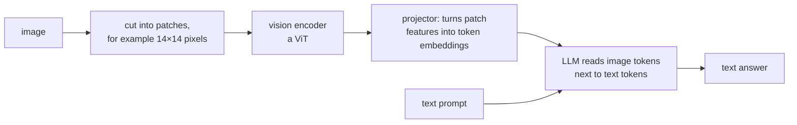

# Multimodal models: images, documents and audio

Most frontier models now accept images (and often audio or video) alongside text. AI engineers use this daily: reading invoices and screenshots, describing photos, answering questions about charts, voice assistants.

## How an image gets into an LLM

An image becomes hundreds or thousands of tokens, depending on its size. That's why **image size drives cost and latency**: resize to what the task needs.

## Key ideas

- **CLIP-style embeddings** put images and text in one vector space (trained by matching 400 million image-caption pairs in OpenAI's CLIP, 2021). Use them for image search, deduplication, and zero-shot labels ("a photo of a damaged parcel").
- **Document understanding:** vision-language models can read scanned PDFs, tables and forms directly. Compare against classic OCR plus layout parsing on your documents: VLMs handle messy layouts well but can misread numbers, and they cost more per page.
- **Audio:** speech-to-text then an LLM, or speech-to-speech models for real-time voice. Latency targets for voice are tight (well under a second to start replying feels natural).

## What to say about quality and safety

- Evaluate per field ("invoice total exact match on 200 invoices"), not by eye.
- Images can carry **prompt injection** too (text written in the picture), so treat them as untrusted input.
- Personal data in images (faces, IDs) has the same privacy rules as text.

The short course *Computer vision: from pixels to modern models* covers how vision models work, from convolutions to ViT and CLIP.

## Practice questions

*How does a vision-language model read an image? How would you extract fields from 10,000 scanned invoices a month, and how would you check accuracy? When would you choose OCR over a VLM?*

## Optional videos

The lesson above is complete on its own. These go deeper, if you like learning by watching.

**An Image is Worth 16x16 Words: ViT paper explained (Yannic Kilcher)**

https://www.youtube.com/watch?v=TrdevFK_am4

**OpenAI CLIP: connecting text and images (Yannic Kilcher)**

https://www.youtube.com/watch?v=T9XSU0pKX2E
