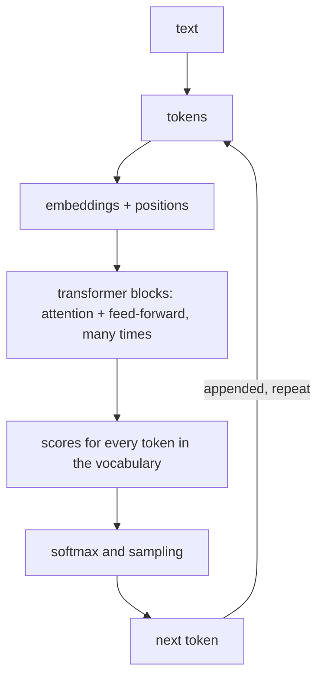

# From tokens to text

The answers interviewers expect, in order:

1. **Tokenization.** Text is split into tokens (sub-words) with a learned vocabulary, usually byte-pair encoding (BPE): frequent character pairs are merged again and again. Rare words become several tokens; Arabic often uses more tokens than English for the same meaning, which costs money and context.
2. **Embeddings.** Each token becomes a vector; position information is added (modern models often use rotary embeddings, RoPE).
3. **Transformer blocks.** Each block has **self-attention** (every token gathers information from earlier tokens, weighted by relevance) and a feed-forward network, with residual connections and normalization.
4. **Next-token prediction.** The last layer gives a score for every vocabulary token; softmax turns scores into probabilities; one token is sampled, appended, and the loop repeats.

> **Optional video above.** 3Blue1Brown's *Attention in transformers, step by step* (26 min), a visual version of step 3. Everything you need is in the text below, so watch it only if it helps you: inPace remembers where you stopped.

## Attention in one paragraph

Each token makes three vectors: a **query** (what am I looking for?), a **key** (what do I contain?) and a **value** (what do I pass on?). A token's query is compared with every earlier token's key (a dot product, divided by the square root of the vector size); a **mask** hides future tokens; softmax turns the scores into weights; the token's new vector is the weighted sum of the values. **Multiple heads** do this in parallel with different learned projections, so one head can track grammar while another tracks names. This is exactly the `attention()` function you wrote in part 2.

## Architectures and training stages

| Type | Example use | Why |
|---|---|---|
| Decoder-only | chat, generation (most LLMs today) | causal attention: each token sees only the past |
| Encoder-only | embeddings, classification, rerankers | bidirectional attention: sees the whole input |
| Encoder-decoder | translation, summarization (T5-style) | encode the input fully, then generate |

**Training stages:** pretraining (next-token prediction on web-scale text) → supervised fine-tuning on instruction examples (instruction tuning) → preference tuning: RLHF trains a reward model from human rankings and optimizes with reinforcement learning (PPO); **DPO** skips the reward model and learns directly from preferred/rejected pairs.
