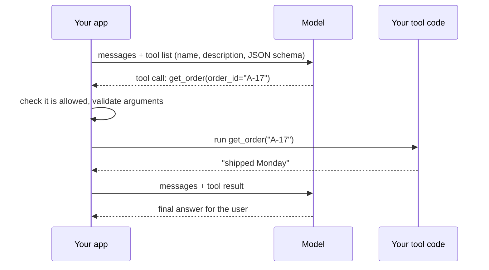

# Structured output and tool calling

Production systems rarely want free text. They want **JSON that matches a schema** (to store, route or validate) and **tool calls** (the model asks your code to do something).

## Structured output

Ask for JSON that follows a schema. Many APIs can **enforce** a JSON schema while generating (often called structured outputs or constrained decoding), so the result always parses. Still validate it in code, because a valid shape can hold wrong values.

```python
from typing import Literal
from pydantic import BaseModel, Field, ValidationError

class Triage(BaseModel):
    category: Literal["billing", "shipping", "bug", "other"]
    urgent: bool
    summary: str = Field(max_length=200)

def parse(raw: str) -> Triage | None:
    try:
        return Triage.model_validate_json(raw)
    except ValidationError as err:
        # retry once: send the model its output and str(err), ask for a fix
        return None

print(parse('{"category": "shipping", "urgent": false, "summary": "Late parcel"}'))
print(parse('{"category": "weather", "urgent": false, "summary": "?"}'))
```

The first call prints a `Triage` object; the second prints `None`, because `weather` isn't an allowed category. Tips that interviewers like to hear:

- Put the **reasoning before the answer** in the schema (a `reason` field first) when the task needs thought; the model writes in order.
- Use **enums** for anything you route on; free text can't be routed reliably.
- Keep schemas small and flat; deep nesting raises error rates.

## Tool calling



- You describe tools with names, descriptions and JSON schemas; the model returns a tool name and arguments; **your code** runs it and sends back the result. The model never executes anything itself.
- Models can ask for **several tools at once** (parallel tool calls); run independent ones together to save time.
- **Tool descriptions are prompts.** Say what the tool does, when to use it, what the arguments mean, and what it returns. A vague description is the most common reason a model picks the wrong tool.
- Return **useful errors** ("order id must look like A-17") instead of stack traces: the model can recover from a clear error.
- Fewer, well-named tools beat many overlapping ones.

## Practice questions

*How do you make sure the model's output is valid JSON? What happens when a tool fails? How do you stop a model from calling a dangerous tool? What's the difference between function calling and structured output?* (Answer for the last one: structured output shapes the final answer; a tool call is a request for your code to act, after which the model continues.)
