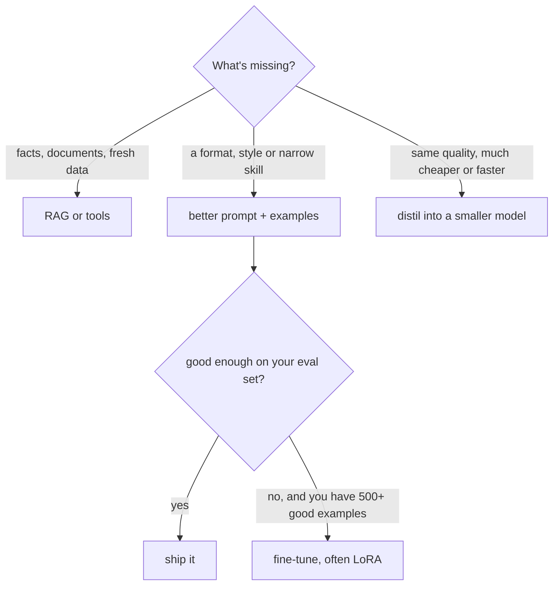

# Prompting, RAG or fine-tuning?

The classic interview question. Answer with what each changes:

| Need | Best first tool | Why |
|---|---|---|
| The model lacks **knowledge** (your documents, fresh facts) | **RAG** | facts stay editable, citable, permissioned |
| The model lacks a **behaviour or format** (a style, a schema, a narrow task) | **prompting**, then **fine-tuning** if prompting can't get there | fine-tuning teaches *how*, not *what* |
| **Cost or latency** at high volume | fine-tune a **smaller** model on the big model's good outputs (distillation) | cheaper per call once it's good enough |

Start with prompting, measure, add RAG for knowledge, fine-tune only with evidence and a good evaluation set. **LoRA / PEFT** fine-tunes small added matrices instead of all weights: far less memory, and you can swap adapters.

## Practice questions

*When would you fine-tune instead of using RAG? What is instruction tuning? What is PEFT/LoRA and when would you use it? How do you turn user edits and acceptances into training signals? When is a small open-source model "good enough"?*

## A decision you can draw

Module "Modern models" covers how LoRA, QLoRA and preference tuning work in practice, and what they cost.
