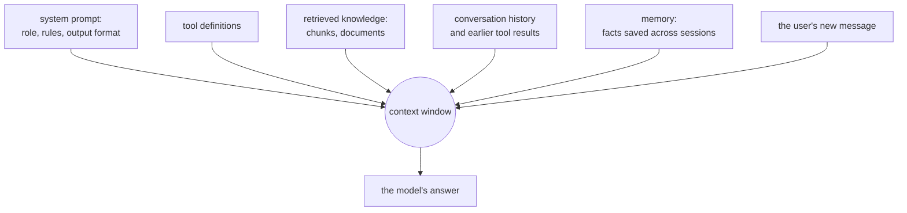

# Context engineering and prompt caching

**Context engineering** is deciding what goes into the model's window on every call, in what order, and what gets cut. The term spread in 2025 because, as systems grew into agents with tools and memory, most quality problems turned out to be context problems, not wording problems.

## What competes for the window

Everything costs tokens and attention. Models find facts at the start and end of a long context more reliably than in the middle ("lost in the middle"), and quality usually drops before the window is full. So more context is not automatically better.

## The techniques

| Technique | When |
|---|---|
| **Select:** retrieve only the top chunks, load only the tools this step needs | always |
| **Order:** stable instructions first, the question last; put the key evidence near the question | always |
| **Compress:** summarise old turns, keep only the useful part of a tool result | long chats and agent loops |
| **Isolate:** give a sub-task to a sub-agent with its own clean context, return only its summary | big research or coding tasks |
| **Persist:** write notes or a to-do file outside the window and re-read it | long-running agents |

## Prompt caching

Providers can cache the processed start of a prompt (the **prefix**) and reuse it when the next request starts the same way. Cached tokens are cheaper and faster, often by a large factor; check your provider's current price list. The one rule that makes it work: **put what doesn't change first** (system prompt, tool definitions, long reference documents), and what changes last (the history and the new message). One changed character near the start breaks the cache for everything after it, so don't put the current time or a request id at the top of your system prompt.

## Practice questions

*What is context engineering, and how is it different from prompt engineering? Your agent gets worse after 30 steps: why, and what would you do? How would you lay out a prompt to get the most from prompt caching?*
