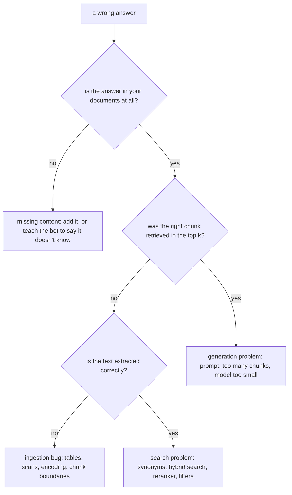

# Debugging a RAG that's confidently wrong

A favourite scenario question. Walk through it like an investigation, not a guess:

1. **Collect failures:** 20 to 50 real bad answers with the question, retrieved chunks and answer.
2. **Classify each:** was the right chunk retrieved? If not: an ingestion problem (text missing or broken) or a search problem (wrong ranking, synonyms, filters). If yes: a generation problem (ignored the context, mixed sources, the prompt).
3. **Count the categories** and fix the biggest one first.
4. **Add the failures to the golden set** so they stay fixed.
5. **Re-run the evals** and compare before and after.

This is **error analysis**, the habit evaluation experts like Hamel Husain and Shreya Shankar put first: look at the data before building metrics. Say "I'd read 50 failures and categorise them" and you'll sound like someone who has shipped.

## An example of the count

After reading 40 failures of a policy assistant, you might find:

| Category | Count | First fix |
|---|---|---|
| Table text extracted as one line | 14 | a layout-aware PDF parser |
| Right chunk ranked 8th to 20th | 11 | add a reranker |
| Answer in no document | 9 | an "I don't have that" check and a content request to the team |
| Model mixed two policies | 6 | cite per sentence; fewer chunks |

The table *is* the answer to the interview question: it shows you measure, prioritise and fix in order. Then say how you'd prevent a regression: the 40 cases join the golden set and run in CI.
