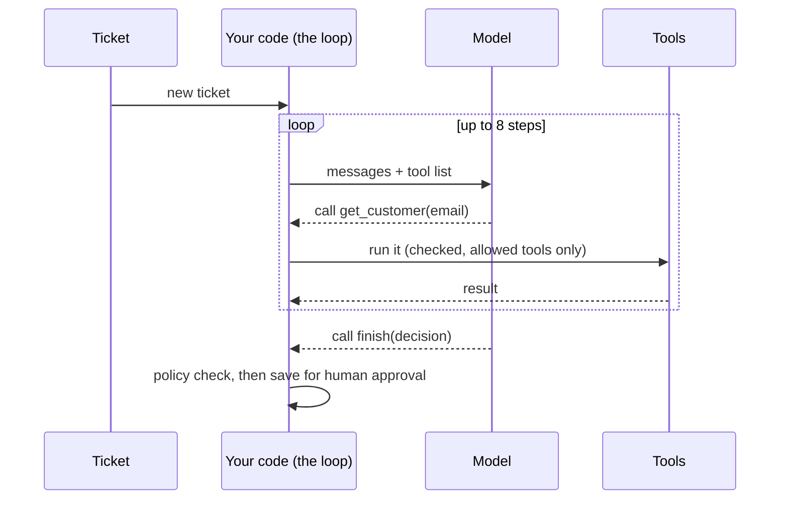

# Agents: patterns, and when not to use them

Anthropic's engineering post [Building effective agents](https://www.anthropic.com/engineering/building-effective-agents) (December 2024) gives the vocabulary interviewers use. It separates **workflows** (your code fixes the path) from **agents** (the model decides its next step in a loop, using tools and feedback):

| Pattern | What it is | Use it when |
|---|---|---|
| Prompt chaining | steps in sequence, each call uses the last output | the task splits into fixed steps |
| Routing | classify, then send to a specialised prompt or model | inputs fall into clear types (and cheap ones can go to a small model) |
| Parallelization | several calls at once, then combine (sections or votes) | independent parts, or you want several opinions |
| Orchestrator-workers | one call plans subtasks, workers do them | you can't know the subtasks in advance |
| Evaluator-optimizer | one call drafts, another critiques, loop | clear quality criteria exist |
| Agent | the model chooses tools in a loop until done | open-ended tasks where the steps can't be predicted |

## The answers that score

- **Start simple.** The post's main advice: the simplest solution that works, adding complexity only when it measurably helps. Many "agent" problems are a single call with retrieval, or a fixed workflow.
- **Agents trade cost and latency for flexibility**, and their errors compound over steps.
- **Control flow belongs in code**, not in prompts: step limits, stop conditions, permissions, approvals.
- **Components beyond the LLM:** tools with clear schemas, memory/state, a loop with limits, tracing, evals, guardrails.
- **Tool safety:** an allow-list, validated arguments, least privilege, sandboxing for code, human approval for anything irreversible, and idempotent tools so retries can't do things twice.
