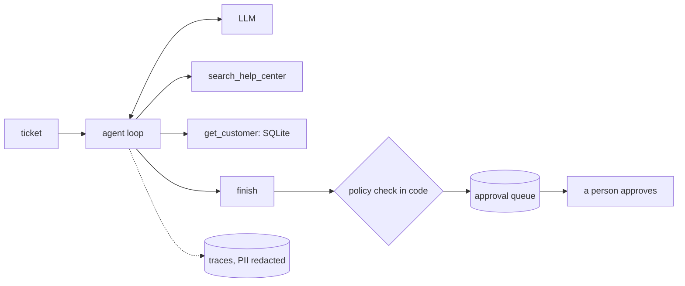

# TriageBot, step 1: design and tools

Your second project mirrors the take-homes the field guide collected (agents are 30%+ of them): a **support-ticket agent**. For each ticket it looks up the customer, searches the help center (your DocAnswer search, reused), then decides: **reply** with a cited draft, or **escalate** to a person. Nothing reaches a customer until a person approves it.



## Design decisions, before code

- **Tools:** read-only first (`search_help_center`, `get_customer`) and one `finish` tool whose arguments are the structured decision. No tool can send messages or refund money.
- **Limits:** at most 8 steps; past that, escalate. A token budget per ticket.
- **Policy in code:** refunds over 100 USD and legal threats always escalate, whatever the model says.
- **Data:** a small SQLite customer table, and 20 to 40 help-center articles (write them, or use a real product's public FAQ).

```python
# triagebot/tools.py
"""The tools the agent may call: JSON schemas for the model, and the Python that runs them."""
import re
import sqlite3

DB_PATH = "data/customers.db"
HELP_CENTER = None        # set at startup: a DocAnswer Searcher over the help-center articles


def schema(name, description, properties, required):
    return {"type": "function", "function": {
        "name": name, "description": description,
        "parameters": {"type": "object", "properties": properties, "required": required, "additionalProperties": False}}}


TOOLS = [
    schema("search_help_center", "Search the help-center articles. Returns the 3 best passages with their source.",
           {"query": {"type": "string"}}, ["query"]),
    schema("get_customer", "Look up a customer by email: plan, signup date and number of open orders.",
           {"email": {"type": "string"}}, ["email"]),
    schema("finish", "Give the final decision for this ticket. Call it exactly once, at the end.",
           {"category": {"type": "string", "enum": ["billing", "bug", "account", "how_to", "other"]},
            "priority": {"type": "string", "enum": ["low", "normal", "high"]},
            "action": {"type": "string", "enum": ["reply", "escalate"]},
            "reply": {"type": "string", "description": "the draft reply, citing help-center sources like [1]"},
            "reason": {"type": "string", "description": "why, in one sentence"}},
           ["category", "priority", "action", "reason"]),
]


def search_help_center(query):
    return [{"n": i, "source": c["source"], "text": c["text"][:600]}
            for i, c in enumerate(HELP_CENTER.search(query, k=3), 1)]


def get_customer(email):
    if not re.fullmatch(r"[^@\s]+@[^@\s]+\.[a-z]{2,}", email, re.IGNORECASE):
        return {"error": "not a valid email address"}
    with sqlite3.connect(DB_PATH) as db:          # parameters, never string formatting: no SQL injection
        row = db.execute("SELECT plan, signup_date, open_orders FROM customers WHERE email = ?", (email,)).fetchone()
    if row is None:
        return {"error": "no customer with that email"}
    return {"plan": row[0], "signup_date": row[1], "open_orders": row[2]}


HANDLERS = {"search_help_center": search_help_center, "get_customer": get_customer}


def run_tool(name, args):
    if name not in HANDLERS:                      # the model can only run what we allow
        return {"error": f"unknown tool: {name}"}
    try:
        return HANDLERS[name](**args)
    except Exception as e:                        # a failing tool reports back; it never crashes the agent
        return {"error": f"{type(e).__name__}: {e}"}
```

Notice what makes these tools safe: JSON schemas with `additionalProperties: false`, an allow-list in `run_tool`, parameterised SQL, input validation, and errors returned to the model instead of crashing the loop.
